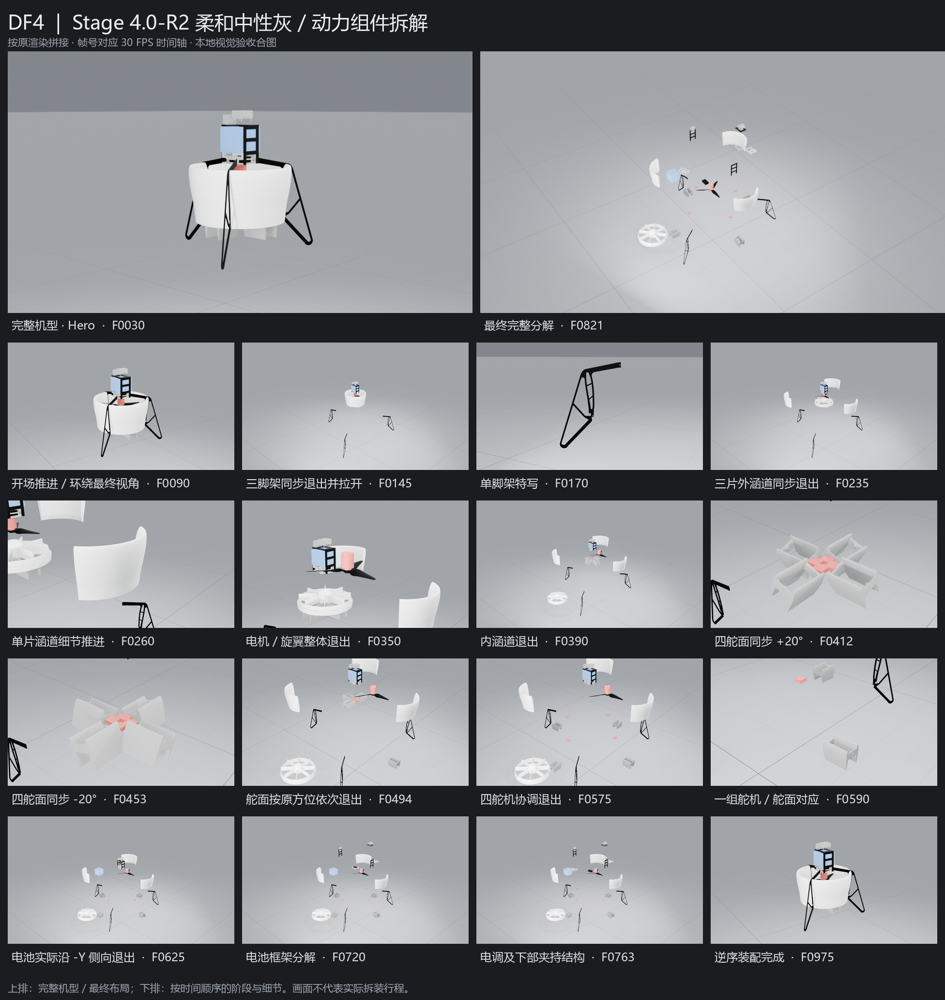

# Stage 4.0-R2 — 视觉、镜头语言与渐进式拆解修订

**STAGE 4.0-R2: READY FOR USER VISUAL ACCEPTANCE**。工程和技术验证完成，用户视觉验收仍为PENDING；本轮到此停止，不进入最终高质量渲染或Premiere。

## 工程与基线

- 唯一正式工程：`<DEV>/output/DF4/DF4.blend`，5,518,390字节。
- 最终SHA256：`766faf3114d05f2b3f0193ae8cc0ecd0aeb0e08f476afcc686e34d59be8af197`。
- DEV main：`4b8dca8ef2e2810f2c40477f8c394ff8c4d49b21`（已推送）；AUDIT提交由本报告所在Git HEAD标识，不在文件内自引用其自身哈希。
- 两仓库经GitHub connector核对均为Public。没有上传Blend、STL、SDF、视频或渲染序列，没有force push、Tag或其他仓库修改。
- 执行前重新fetch两仓库，实际R1 DEV为`33834c8ba51e0a400477c64d148a5eb87a51a880`，AUDIT为`38a40c7c5394a75c43ae6c3296d68648b03210b8`，本地干净且与远端一致。

任务文本所列489553c1…/f38b2f43…属于更早版本，未据此回退。实际R1正式工程SHA256为`da631cf33dfc6ecb8a4c0a1393b13831067967f79fb83886a1dee0bf18629287`，先运行R1完整回归PASS，再逐字节备份到`.work/stage-4-r2/rollback/DF4.blend`。所有修改先在临时副本执行；正式apply核对原文件/备份SHA、副本审批、配置SHA和高密几何检查副本SHA，保存后新进程重新运行全部回归。最终仅保留正式DF4.blend，备份与临时副本结束清理。

## 背景、灯光与色彩

采用Soft Neutral Studio Gray。World `#85898F`、Ground `#A0A3A8`、主网格`#202326`、次网格`#41464B`为sRGB参考，先解码为线性输入，再经AgX显示；没有把sRGB值直接当线性颜色。原7个零件材质及分配全部保留，没有为展示改变机体材质。

地面保留深色弱网格，主/次世界宽度约3.2/1.4mm，随距离淡出，网格不铺在背景。屏幕像素宽度随透视变化，不声称全画面恒定像素宽度。沿用六灯，主光、正面补光和双侧轮廓光扩大面积、降低尖锐高光；地面低金属度、粗糙度0.8，AgX曝光-0.1。实际渲染与GUI检查中黑色脚架边界可辨，白色涵道保有层次；最终效果待用户判断。

## 镜头语言

DF4保持原始直立姿态，展示姿态根无Action、无人工倾斜；开场全部26个非旋翼可见网格世界矩阵误差为0。旋翼局部慢转保留。

前三秒，Camera A从较低的机头侧前方缓慢推进，在约20°圆弧上升高，至稳定三分之四视角停稳。随后以稳定主镜头交代脚架与外涵道的同步退让；每组到位后，仅选择一个结构作短促近景。动力段把电机与旋翼视作一个完整组件，镜头跟随共同位移轻推，不再拆成两个段落。斜俯视Camera B保持稳定，让四舵面的同步正负偏转与四象限关系清楚可读。舵面依次退出、舵机协调退出后，只切入一组对应关系近景。电池、框架、电调与夹持件均回到主镜头连贯揭示。全机分解后保持两秒，镜头缓慢升高、后退并有限转向；继而固定主镜头观看逐组逆序回装，最后停在完整机型。

全段14章，Camera C仅四类特写：单脚架、单外涵道、完整动力组件、一组舵机/舵面。飞控和电调仍参与拆解，没有独立特写；不添加摇臂、连杆或螺丝。1–90开场；91–180脚架；181–270外涵道；271–360动力；361–390内涵道；391–480舵面功能；481–600舵面/舵机退出；601–720电池/框架；721–765电调/夹持件；766–825完整分解；826–945逆序装配；946–990完整机型保持。30FPS、990帧、33秒。

## 拆解位移配置

下表是FLU米制的展示位移，不是实际拆装行程。完整避让折线在配置waypoints/return_waypoints中；动力/内涵道等不按端点直线穿过原机体。

| 模块 | 退出帧 | 最终展示位移[m] | 返回帧 |
|---|---:|---|---:|
| LEG1 / 脚架1 | 91–145 | [0.175, -0.3031088913245535, -0.4] | 938–944 |
| LEG2 / 脚架2 | 91–145 | [-0.35, 0, -0.4] | 938–944 |
| LEG3 / 脚架3 | 91–145 | [0.175, 0.3031088913245535, -0.4] | 938–944 |
| DUCT1 / 外涵道1 | 181–235 | [0.38, 0, 0.02] | 931–937 |
| DUCT2 / 外涵道2 | 181–235 | [-0.19, 0.32908965343808666, 0.02] | 931–937 |
| DUCT3 / 外涵道3 | 181–235 | [-0.19, -0.32908965343808666, 0.02] | 931–937 |
| POWER / 电机与旋翼完整组件 | 281–340 | [0.38, -0.28, 0.18] | 924–930 |
| INNER_DUCT / 内涵道 | 361–382 | [0, -0.6, -0.32] | 917–923 |
| SURFACE1 / 舵面1 | 481–494 | [0.32, 0, -0.39] | 910–916 |
| SURFACE2 / 舵面2 | 499–512 | [0, -0.32, -0.39] | 903–909 |
| SURFACE3 / 舵面3 | 517–530 | [-0.32, 0, -0.39] | 896–902 |
| SURFACE4 / 舵面4 | 535–548 | [0, 0.32, -0.39] | 889–895 |
| SERVO1 / 舵机1 | 553–575 | [0.23, 0, -0.24] | 882–888 |
| SERVO2 / 舵机2 | 553–575 | [0, -0.23, -0.24] | 882–888 |
| SERVO3 / 舵机4（展示对应舵面3） | 553–575 | [-0.23, 0, -0.24] | 882–888 |
| SERVO4 / 舵机3（展示对应舵面4） | 553–575 | [0, 0.23, -0.24] | 882–888 |
| BATTERY / 电池 | 601–624 | [0, -0.38, 0] | 875–881 |
| FLYBOARD / 上框与飞控 | 626–649 | [0, 0.28, 0.15] | 868–874 |
| PANEL_FRONT / 前侧板 | 651–671 | [0.25, 0, 0.09] | 861–867 |
| PANEL_REAR / 后侧板与GPS固定平面 | 674–695 | [-0.25, 0, 0.09] | 854–860 |
| SHELF / 下框 | 697–717 | [0, 0.4, -0.04] | 847–853 |
| ESC / 简化电调 | 721–740 | [0.26, -0.25, 0.1] | 840–846 |
| CLAMP1 / 脚架夹持片1 | 742–752 | [0, -0.28, 0.06] | 833–839 |
| CLAMP2 / 脚架夹持片2 | 755–763 | [0, 0.28, 0.06] | 826–832 |

三脚架沿共同向下退出叠加小幅径向分散，最终中心最小间距0.827m，大于R1约0.775m。三片涵道按原方位同步拉开。两块夹持片最后退出，不称为完整盒体。

## 动力组件与舵面

新增唯一POWER平移Empty，既有MOTOR/ROTOR展示模块作为静态子层，原Rotor局部关节/NLA保留在下层。电机和旋翼保持两个独立Mesh对象并共享原数据；共同位移只改变展示位置。剥离允许的局部旋翼自转后，完整安装矩阵误差0、相对位置误差约1.86e-9m、旋翼轴向误差0。原旋翼Action通过显式NLA scale40重定时，约30°/s、累计360°，末态方向恢复；没有重制Stage2 Action。

四舵面391–480同步执行0→+20°→0→-20°→0，正/负极值总览分别为412/453帧。最大角度误差1.13e-6°，0.25帧求值最大0.3490658482rad，小于SDF 0.3491rad。功能展示结束后四舵面依次退出，之后四舵机协调退出；对应关系保持Servo1/cs11、Servo2/cs2、Servo4/cs33、Servo3/cs4。

## 电池实际轨迹与几何验证

直接读取实际R1 Blend的Location关键帧和世界包围盒轨迹，测得退出差值`[0, -0.3799999952, 0]`m，匹配R1配置和历史R1报告的-Y 380mm。更早Stage4.0曾使用+Z 400mm，不将该记录误作实际R1，也不改写历史报告。本轮保留正确侧向路径，只重定时到601–624，返回875–881。

对电池长方体与panel11、panel12、base_board_flyctrl、shelf1等9件实际三角网格重新检查：±Y完整连续0.38m扫掠无穿透；+X被panel11阻挡，-X被panel12/X-tend阻挡。另检查实际进出31个整数帧，无穿透。X-tend与电池包围盒重叠但三角检查无实体相交，不擅自改变源安装关系。详见`evidence/stage-4.0-r2/r1_battery_actual.json`、`battery_path.json`。

## 回归与实际打开

| 检查 | 结果 |
|---|---|
| 原Scene对象/网格/材质/Action | PASS，117/33/7/29；原层级、矩阵、几何/法线、材质节点/归属、Action全部关键帧/句柄/插值保持 |
| Stage2五机械关节、Stage3二十四爆炸控制器、FLU | PASS，历史完整断言通过，原DF4_ROOT不变 |
| R1展示72对象与27共享实例 | PASS，全部保留；仅新增POWER空物体，展示73/全局190对象 |
| 开场本体不倾斜、相机推进升高 | PASS，非旋翼本体误差0，相机实际圆弧20.0000004° |
| 脚架/涵道/舵机同步与四舵面依次退出 | PASS，同步因子最大差7.07e-8，退出顺序符合配置 |
| 动力组件/旋翼轴/舵面角度 | PASS，详见上节及保存后回归 |
| 全990帧轨迹、组合零件相对矩阵 | PASS，最大误差0 |
| Camera A全机与B/C关注部件入画 | PASS，最小归一化边距约9%/10% |
| 逆序回装末态世界矩阵 | PASS，最大误差2.45e-16 < 1e-6 |
| 实际三角BVH自适应几何检查 | PASS，17,245子帧，角点位移约1mm，未发现新增相交对 |
| 正式保存后独立进程完整重开 | PASS，最终文件SHA与GUI及报告一致 |
| 最终副本/正式渲染输入签名 | PASS，完全一致，几何筛查对应副本SHA准确绑定 |
| 原输入34文件、Python编译/注释和Git空白检查 | PASS，输入SHA与Stage1逐项一致 |
| 本机Blender5.0.1完整播放 | PASS，观察完整循环，精确复查75/350/412/453/625/821/913/975帧 |
| 最终重新打开 | PASS，STAGE4_PRESENTATION、Camera A、Frame1、停止播放，Timeline覆盖1–990，窗口保持打开 |

全机检查保留源装配已有20对边界接触/相交，未将其冒充新动画问题，亦未更改原装配。自适应实际网格检查与视觉复核未发现新增明显穿插，但不声称制造公差或数学意义全机连续碰撞证明；电池另有完整连续扫掠检验。GUI截图仅为临时布局/播放证据，不冒充最终渲染，结束清理。

## 唯一视觉交付及操作

一张1952×2064总览图，18个画面全部来自最终正式工程实际Eevee渲染；上排完整Hero与完整分解，下方中文阶段名及帧号。按本轮明确路径存入Audit平级evidence，一张总览图随报告提交；历史images目录仍忽略，不上传大量PNG。不生成任何新视频或MP4。所有中间渲染/GUI截图与副本均限于`.work/stage-4-r2/`并清理。

打开DF4.blend即为Camera A、第1帧。鼠标放在主画面或Timeline上按空格播放/暂停；误离开相机视角按数字小键盘0，或View → Cameras → Active Camera。直接点击Timeline可检查指定帧；T01–T14表示镜头章节。无需修改参数、关键帧或对象位置，中文简要说明在DEV `docs/stage4-acceptance.md`。

## 未解决问题与停止点

无新增技术阻塞。来源模型已有的简化几何、接触/相交和悬空安装现状保留；没有为展示修正源结构。33秒节奏、特写可读性和4秒逐组回装观感仍待用户人工验收。READY仅为交付完成，不表示用户已通过视觉验收。窗口按最新要求保持打开，不自动播放；等待用户反馈。
