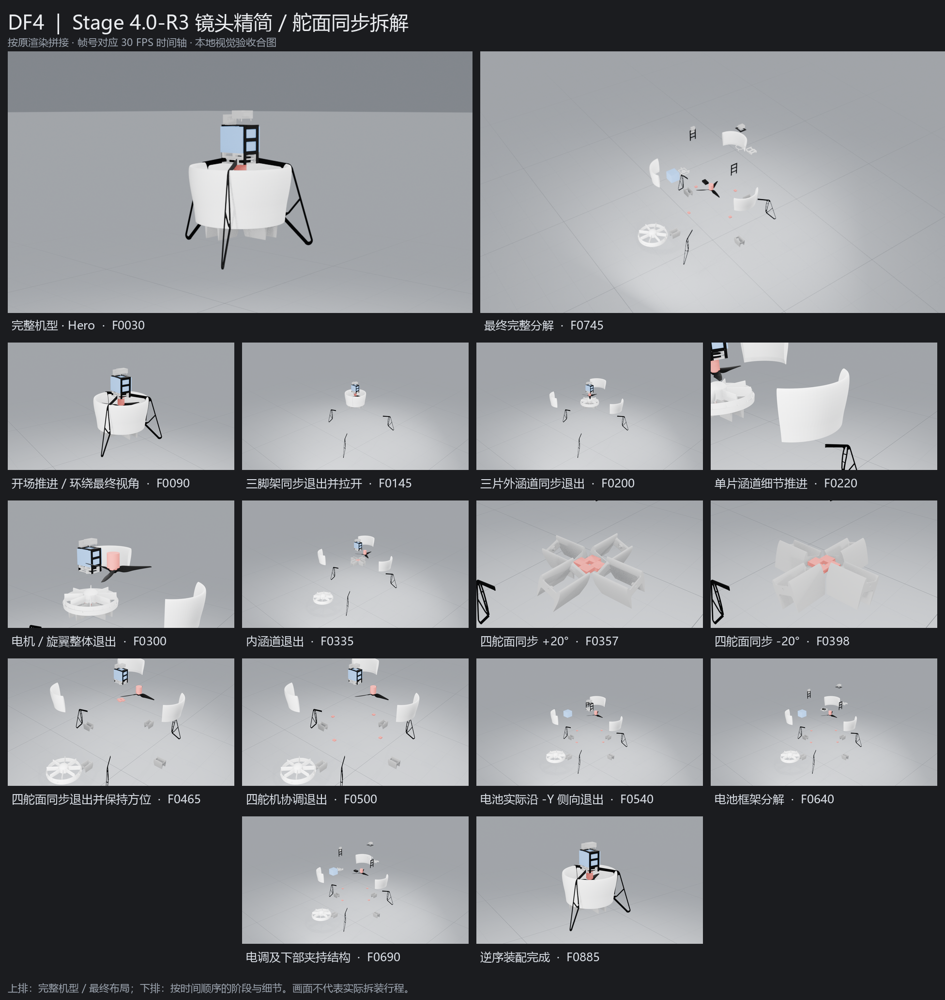

# Stage 4.0-R3 — 镜头精简与机械拆解节奏优化

**STAGE 4.0-R3: READY FOR USER VISUAL ACCEPTANCE**。工程交付完成，用户视觉验收PENDING；本轮停止，等待用户检查，不进入最终高质量渲染或Premiere。

## 当前工程与基线

- 唯一正式工程：`<DEV>/output/DF4/DF4.blend`，5,519,908字节。
- 最终SHA256：`cfafc7c7245654409a378a7c16267251a3307863dfcfb6c288ac53c1674295a0`。
- DEV main：`e38ecc3f646eaccdd16c13cf7cc6593fce02a870`（已推送）；AUDIT提交由本报告所在Git HEAD标识，最终交付消息列出其完整哈希。
- 执行前两个仓库重新fetch，本地干净、远端一致：DEV `4b8dca8ef2e2810f2c40477f8c394ff8c4d49b21`，AUDIT `22fd66ddde334242c71990ca610f30fa6c7afad6`。两个仓库经GitHub connector核对保持Public。
- 实际R2工程SHA256：`766faf3114d05f2b3f0193ae8cc0ecd0aeb0e08f476afcc686e34d59be8af197`。先运行现有完整回归PASS，逐字节备份到`.work/stage-4-r3/rollback/DF4.blend`，临时副本完成修改与全部技术验证后才更新正式工程。没有回退R1。

正式apply核对原工程/备份SHA、已通过的副本审批与配置、高密几何筛查对应副本SHA，保存后独立进程重新打开并运行完整回归，失败则恢复原字节。GUI保存默认布局后再对最终字节复验，报告、GUI和回归哈希一致。

## 本轮删除与保留

删除单脚架独立特写、舵机/舵面对应独立特写。Camera C仅保留单片外涵道细节201–230和完整动力组件231–305两段；飞控、电调均无独立特写。10个镜头章节替代R2的14章，主相机字母的实际变化由7次减至4次；章节标记不等于相机切换次数。同一C相机的涵道/动力段仍有必要的细节构图切换。

三脚架同步退出保留，1–145帧实际轨迹相对R2逐帧误差0，原退出端点/径向避让和最终间距保持。三片外涵道继续同步退出，单片细节推进保留。全部24模块的原零件成员、位移端点及避让折线向量与R2一致，本轮仅重排时间；见`evidence/stage-4.0-r3/r3/preserved_design.json`。

摄影棚保留Soft Neutral Studio Gray：中性灰World/地面、黑色或近黑色网格、较粗主线/较细次线、远处淡出。sRGB参考继续线性解码、AgX显示；原零件材质不变。世界/地面节点、五个主灯和颜色管理签名相对R2不变；第六盏跟随特写的6W补光只按现存两段C镜头重新触发，避免已删除特写的旧补光时段。黑脚架与白涵道层次已复核。

开场保留R2原1–90帧相机采样，比较误差0；本体不倾斜，所有26个非旋翼可见网格开场世界矩阵误差0。低机位侧前方推进、升高和20°有限圆弧保持，灯光揭示与原旋翼慢转保留。

## 四舵面同步偏转、退出和返回

336–425四舵面使用独立展示四元数Action，同步0→+20°→0→-20°→0。最大角误差1.13e-6°；0.25帧采样最大0.3490658482rad < SDF 0.3491rad，原Stage2机械Action不变。

全部回零后，cs11、cs2、cs33、cs4同在426开始、465到位，使用相同smoothstep采样进度和LINEAR分量插值；466–470短暂停留。四个独立对象/网格及各自四象限方向保持，未合并几何。随后四舵机471–500协调退出，501–505保持，配对1/cs11、2/cs2、4/cs33、3/cs4不变。

Camera B沿用R2偏转近景与退出全景：336–425和426–505分别固定斜俯视构图，每段相机矩阵变化0；在426运动开始的零位帧切到更宽的B构图，不做环绕，不逐舵面切镜头。回装时四舵面同组同步返回。全900帧实际求值同步/轨迹检查通过，同步因子最大差7.07e-8。

## 完整动力与电池路径

电机/旋翼继续由已有POWER共同平移，不新增控制层或合并对象。剥离允许的旋翼局部自转后安装矩阵误差0，相对位置误差1.86e-9m，轴向误差0。原旋翼Action通过NLA scale40复用，约30°/s、累计360°，末态方向恢复。内涵道仍在动力退出后单独让开。

电池保留真实-Y 380mm侧出，506–540退出，回装时沿反向路径返回；没有+Z直拔。重新对panel11、panel12、base_board_flyctrl、shelf1等9件实际三角网格检查连续侧向扫掠：±Y无穿透，±X受侧板阻挡。实际退出35帧、返回8帧共43个整数帧另行复核无穿透，全片子帧检查也覆盖此过程。上框与飞控、panel12与X-tend共同移动，原相对矩阵不变；不修正源模型既有悬空/接触关系，不增加螺丝或连杆。

## 最新镜头清单与时间轴

30FPS，1–900，共30秒。脚架/涵道由主镜头连贯交代，控制系统仅由B交代，飞控/电调自然参与全景。

| 章节 | 帧 | 相机 | 内容 |
|---|---:|---|---|
| T01 | 1–90 | A | Hero相机推进与有限环绕 |
| T02 | 91–200 | A | 脚架与外涵道同步退出 |
| T03 | 201–230 | C | 单片外涵道细节 |
| T04 | 231–305 | C | 完整动力组件 |
| T05 | 306–335 | A | 内涵道退出 |
| T06 | 336–505 | B | 四舵面功能与同步退出、四舵机退出 |
| T07 | 506–690 | A | 电池框架、电调和夹持件 |
| T08 | 691–750 | A | 完整分解停留 |
| T09 | 751–870 | A | 逆序装配 |
| T10 | 871–900 | A | 完整机型收尾 |

| 模块 | 退出帧 | 返回帧 |
|---|---:|---:|
| LEG1 | 91–145 | 859–870 |
| LEG2 | 91–145 | 859–870 |
| LEG3 | 91–145 | 859–870 |
| DUCT1 | 146–200 | 851–858 |
| DUCT2 | 146–200 | 851–858 |
| DUCT3 | 146–200 | 851–858 |
| POWER | 241–300 | 839–850 |
| INNER_DUCT | 306–327 | 831–838 |
| SURFACE1 | 426–465 | 823–830 |
| SURFACE2 | 426–465 | 823–830 |
| SURFACE3 | 426–465 | 823–830 |
| SURFACE4 | 426–465 | 823–830 |
| SERVO1 | 471–500 | 815–822 |
| SERVO2 | 471–500 | 815–822 |
| SERVO3 | 471–500 | 815–822 |
| SERVO4 | 471–500 | 815–822 |
| BATTERY | 506–540 | 807–814 |
| FLYBOARD | 541–570 | 799–806 |
| PANEL_FRONT | 571–590 | 791–798 |
| PANEL_REAR | 591–610 | 783–790 |
| SHELF | 611–640 | 775–782 |
| ESC | 641–660 | 767–774 |
| CLAMP1 | 661–675 | 759–766 |
| CLAMP2 | 676–690 | 751–758 |

691–750完整分解保持2秒，镜头沿用缓慢升高、后退与有限圆弧后停稳。751–870按14组逆序回装共4秒，同组舵面/舵机/涵道/脚架同步返回，动力组件整体返回。871–900完整机型停留1秒。位移全部归零、末帧世界矩阵最大恢复误差2.45e-16 < 1e-6；不瞬移、不隐藏零件。

## 回归与实际打开

| 检查 | 结果 |
|---|---|
| 原117对象/33网格/7材质/29 Action | PASS，层级/安装矩阵/几何法线/材质节点与分配/全部关键帧句柄插值保持 |
| 五机械Action、24爆炸控制器和FLU | PASS，原Stage1–3历史断言源码未修改，独立保存后回归通过 |
| R2展示73对象、27共享实例 | PASS，不增删展示对象、不改父级；全局190对象保持 |
| R2旧配置与新验证器兼容 | PASS，仍验证实际R2相同字节与990帧，不削弱历史R2条件 |
| 开场相机与脚架原运动 | PASS，逐帧比较误差均0 |
| 摄影棚/原零件材质、动力相对安装 | PASS，外观签名保持，动力矩阵误差0 |
| 舵面同步偏转/退出/返回 | PASS，角度与0.25帧限位、900帧轨迹和同组进度符合配置 |
| Camera B段内稳定 | PASS，两段各自相机矩阵变化0 |
| A全机与B/C关注部件入画 | PASS，最小归一化边距约9%/10% |
| 电池连续扫掠与43个实际进出帧 | PASS，-Y侧出，无穿透 |
| 全片实际三角BVH检查 | PASS，13,981个约1mm自适应子帧，无新增相交零件对 |
| 最终回装/全部900帧轨迹 | PASS，恢复误差2.45e-16，轨迹误差0 |
| 最终副本与正式工程签名 | PASS，渲染输入和几何运动输入均一致，筛查SHA准确绑定 |
| 源输入34文件、Python编译/中文注释/Git检查 | PASS，原输入SHA与Stage1清单一致 |
| 本机Blender5.0.1完整播放 | PASS，观察完整循环，精确检查75/200/220/300/357/398/445/485/540/745/830/885帧 |
| 最后重新打开 | PASS，展示Scene、Camera A、Frame1、停止播放，Timeline完整1–900，窗口保持打开 |

原装配已有20对边界接触/相交单独保留，不修改历史机械结构，也不将其报告成新增动画问题。检查未发现新增明显穿插，但不声称制造公差或数学意义的全机连续碰撞证明；电池另有完整连续扫掠检验。

## 唯一视觉交付及清理

一张1952×2064总览图，16个画面全部从最终正式工程实际Eevee渲染；上排完整机型/完整分解，下方中文名称与帧号。没有单脚架、舵机、飞控或电调特写。GUI截图只作临时布局/播放检查，不冒充渲染画面。

没有新MP4或预览视频。分散渲染帧、GUI截图和副本仅存`.work/stage-4-r3/`，完成后通过project_io受限接口清理；output/DF4只留DF4.blend，无blend1/阶段编号工程。R1/R2原报告及证据清单保持原字节，本轮机器记录另存evidence/stage-4.0-r3/r3，R3单列证据清单，不覆盖R2。源码/报告分别提交DEV/AUDIT，不force push、不建Tag、不修改其他仓库。

## 用户检查与未解决问题

打开工程默认Camera A、第1帧，鼠标放在主画面或Timeline上按空格播放/暂停；误离开相机按数字小键盘0或View → Cameras → Active Camera返回。无需修改参数或对象，中文操作说明在DEV `docs/stage4-acceptance.md`。

无新增技术阻塞。原源模型的简化几何、接触和悬空关系保留；30秒节奏与视觉效果仍待用户检查。READY仅代表工程交付完成，不代表用户已通过视觉验收。窗口保持打开、停止播放，等待用户反馈。
