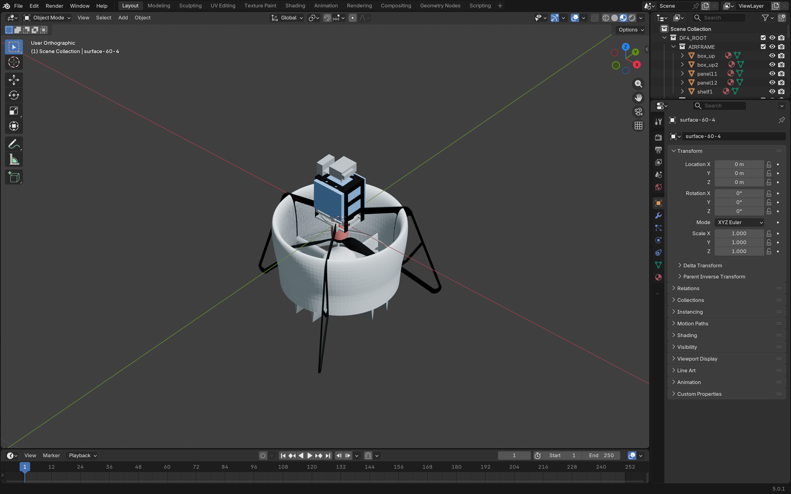
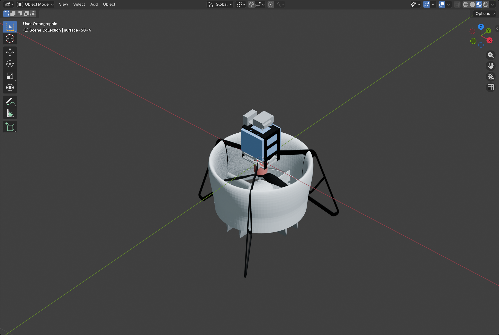
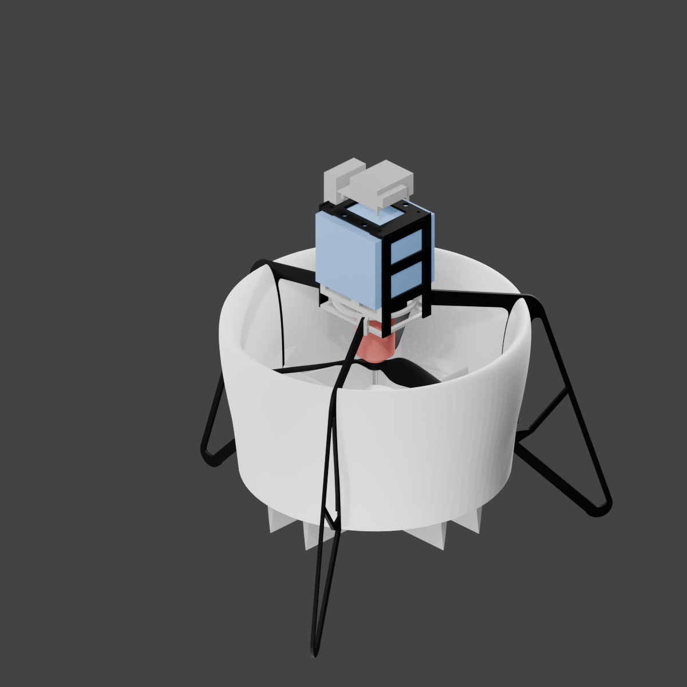

# Stage 1.5 — SDF 材质恢复

| 项目 | 内容 |
|---|---|
| 阶段 | Stage 1.5 |
| 验证机型 | DF4（ducted-fan UAV） |
| 阶段状态 | 已完成并通过本地验收；等待外部复核 |
| 开发仓库 | <https://github.com/tangqingxi/AeroViz-Blender> |
| 开发提交 | `d5b303a6d2ad437c18d85b4315ca7c8e4a23e878`（`main`，已推送；相对交付 Stage 1/1.5 时的 `d956bec…` 只有文档变更——可见性说明与 README 中文化，代码与配置未变） |
| 审计仓库 | <https://github.com/tangqingxi/AeroViz-Blender-Audit>（Public） |
| 原始执行日期 | 2026-11-10 |
| 报告整理日期 | 2026-11-10 |
| 证据清单 | [`evidence-manifest.json`](evidence-manifest.json) |
| 前置阶段 | [`../stage-1/STAGE_1_REPORT.md`](../stage-1/STAGE_1_REPORT.md) |

---

## 1. 阶段目标

1. 从同一份 SDF 描述中提取 `visual/material` 定义，把 Gazebo/OGRE 的漫反射、高光、环境色、透明度、自发光与脚本材质名映射到 Blender Principled BSDF。
2. **不修改** Stage 1 的几何、层级、关节与相机：材质步骤只允许"加材质 + 加展示灯"。
3. 对同一材质定义做**确定性复用**，使重复执行不产生新材质、不改变槽位绑定（幂等）。
4. 对无法恢复原始颜色的对象**显式归类**并说明理由，不用猜测的颜色冒充原始涂装。
5. 用真实图形进程重新打开最终工程，核对结构与材质，并捕获 Material Preview 与 Eevee 预览。

本阶段**不包含**：机械运动、关键帧、动画、爆炸视图、镜头编排与视频渲染。Stage 1.5 结束时工程仍然是**静态**的：全部对象均无 `animation_data`，没有任何关节被驱动。

## 2. 执行环境

| 项目 | 值 |
|---|---|
| 操作系统 | Windows 11 家庭中文版，10.0.26200（Build 26200） |
| CPU / 内存 | Intel Core i7-14650HX（16 核 / 24 线程）/ 15.6 GB |
| GPU | NVIDIA GeForce RTX 5060 Laptop GPU；Intel UHD Graphics；ToDesk 虚拟显示器 |
| Blender | 5.0.1，build hash `a3db93c5b259` |
| Blender 内置 Python | 3.11.13 |
| 渲染引擎 | `BLENDER_EEVEE`（不使用 Cycles） |
| 输入工程 | `output/DF4/DF4_Stage1.blend`（哈希见 §9 第 2 条） |
| 输出工程 | `output/DF4/DF4_Stage1_5.blend` |

## 3. 实现内容

代码位于开发仓库 `scripts/materials.py`（可作为模块导入，也可独立运行）与 `assets/materials/gazebo_standard.json`（已知脚本材质数值库）。

| 能力 | 实现 |
|---|---|
| SDF 材质提取 | `extract_sdf()`：逐 `link/visual` 记录 `ambient`/`diffuse`/`specular`/`emissive`/`transparency`/`script name`/`script uri`/`lighting`，并保留原始 geometry 与 mesh URI |
| 颜色优先级 | 显式 `diffuse` → 已知 Gazebo 脚本名 → 保留外来已有材质 → 配置中的中性展示默认；每一步都在分配表里写明 `source` |
| 透明度 | `Alpha = diffuse.a × (1 − transparency)`；`< 1` 时材质切换为 `DITHERED` |
| 高光映射 | `specular` RGB 均值 → Specular IOR Level，`IOR = 1.5`，`Metallic = 0`，`Roughness = 0.62`（配置项） |
| 自发光 | `emissive` → Emission Color，`Emission Strength = 1`；本模型全部为零 |
| 颜色空间 | `source_color_space = "linear"`：按 Gazebo/OGRE 光照反射系数解释，保持原始数值，不做未知的 sRGB 解码；如需 `srgb` 则走标准分段函数 |
| 确定性复用 | 材质名 `SDF_MAT::<label>::<sha256(definition)[:12]>`，同一签名复用同一数据块；同名但签名不同则报错，绝不覆盖 |
| 歧义处理 | 同一 STL 被多个 visual 引用时，先按对象显式 `object_visuals` 绑定，再按 `source_file` + 父 link 收敛，仍不唯一则报错 |
| 覆盖必须留痕 | `overrides` 以对象名为键，强制 `reason`，来源记为 `config_override`，不得伪装成原始色 |
| 结构保护 | 逐对象比较类型、父对象、`matrix_world`/`matrix_basis`/`matrix_parent_inverse`、Collection、隐藏状态、修改器、几何哈希（顶点/拓扑/平滑标志）、关节属性 |
| 幂等校验 | 同一配置连续执行两次，断言材质集合、每个槽位绑定、分配表完全一致，且无新增材质 |
| 保护性断言 | 拒绝 `source_blend == target_blend`、拒绝覆盖 Stage 1 工程；结束时再次核对 Stage 1 工程哈希与 34 个输入文件哈希未变 |

`scripts/gui_verify_materials.py` 负责图形进程复验：重算结构基线、逐对象核对材质名与 BSDF 数值、确认引擎与视口模式、截取整窗与视口截图。

## 4. 验收结果

| # | 验收项 | 判据 | 结果 |
|---|---|---|---|
| 1 | SDF visual 提取 | 与描述文件中的 visual 数一致 | 通过（25 个 visual，25 个带 material 定义） |
| 2 | 材质创建与复用 | 相同定义复用，无重复材质 | 通过（新建 7 个，二次执行新增 0 个） |
| 3 | 对象分配 | 33 个网格对象全部有材质 | 通过（33/33） |
| 4 | 来源归类 | 每个对象可追溯到来源类型 | 通过（13 显式 RGBA / 12 Gazebo 命名 / 8 展示默认） |
| 5 | 无原始材质的对象 | 逐一列出并说明 | 通过（8 个） |
| 6 | 结构一致性 | Stage 1 的 89 个对象全部保持不变 | 通过（89/89，几何哈希与矩阵一致） |
| 7 | 新增对象范围 | 只允许展示灯 | 通过（4 个 `MATERIAL_LIGHT::*`） |
| 8 | 幂等性 | 连续两次执行结果一致 | 通过（`idempotence_passed: true`） |
| 9 | Stage 1 工程未被改动 | 前后 SHA-256 一致 | 通过（`574c1b00…`，见 §9 第 2 条） |
| 10 | 原始输入未被改动 | 34 个输入文件 SHA-256 一致 | 通过（`source_files_unchanged: true`） |
| 11 | 图形进程重开 | `background=false`，89 对象保留、33 对象材质值核对 | 通过（`material_gui_validation.json`） |
| 12 | 视口与引擎 | 视口 `MATERIAL`，引擎 `BLENDER_EEVEE`，studiolight `studio.exr` | 通过 |
| 13 | 视觉检查 | 无材质丢失（洋红）、无明显着色异常 | 通过（人工查看，见 §6） |
| 14 | 无动画 | 全部对象无 `animation_data` | 通过（0 个） |
| 15 | 交付字节复验（2026-11-10） | 只读重开当前 `.blend`，重放结构与材质断言 | 通过（`REVERIFY_OK`） |

## 5. 关键技术参数

### 材质与颜色空间

| 参数 | 值 | 依据 |
|---|---|---|
| `source_color_space` | `linear` | SDF 未标注传递函数，按 Gazebo/OGRE 光照反射系数解释，保持原始数值 |
| `roughness` | 0.62 | 展示近似，非原件参数 |
| `metallic` | 0.0 | 本模型无金属度信息，不臆造 |
| `specular` 映射 | RGB 均值 → Specular IOR Level | 温和近似，**不宣称**等价复现 Gazebo Blinn-Phong |
| `IOR` | 1.5 | Principled 默认介质 |
| 视角变换 | `AgX`，`exposure = 0`，`gamma = 1` | 截图像素不等于原始 RGBA，报告中不据此反推颜色 |
| 预览分辨率 | 1200 × 1200 | Eevee 相机渲染 |

### 生成的 7 个材质

| 材质 | 来源 | 说明 |
|---|---|---|
| `SDF_MAT::Gazebo_White::8192dd01231b` | Gazebo 标准脚本 | diffuse (1, 1, 1, 1) |
| `SDF_MAT::Gazebo_Black::e1f385be44bc` | Gazebo 标准脚本 | diffuse (0, 0, 0, 1) |
| `SDF_MAT::sdf_rgba::599e0cbb3c46` | 显式 RGBA | (0.2, 0.4, 0.75) 电池 |
| `SDF_MAT::sdf_rgba::26bda2d0a666` | 显式 RGBA | (0.72, 0.16, 0.14) 电机与舵机 |
| `SDF_MAT::sdf_rgba::275a120d4904` | 显式 RGBA | (0.4, 0.4, 0.4) 舵面 |
| `SDF_MAT::sdf_rgba::ee00e3e90d78` | 显式 RGBA | (0.55, 0.55, 0.55) 舱体与层板 |
| `SDF_MAT::display_default::d6ed713989a8` | 展示默认 | (0.38, 0.38, 0.38, 1.0)，中性灰，**不代表真实涂装** |

### 分配统计

| 来源 | 对象数 | 说明 |
|---|---|---|
| `sdf_rgba` | 13 | 描述文件直接给出 diffuse |
| `gazebo_named` | 12 | 仅给出 `Gazebo/White` 或 `Gazebo/Black` 脚本名，按标准库恢复 |
| `display_default` | 8 | 无任何可用原始颜色定义 |
| 合计 | 33 | 与 Stage 1 的网格对象数一致 |

### 无原始材质定义的 8 个对象

| 对象 | 性质 | 处理 |
|---|---|---|
| `base.STL` | 隐藏参考件（合并件） | 展示默认；不假定合并件有单一真实颜色 |
| `rotor-iFlight-9inch.STL` | 隐藏参考件（重复件） | 展示默认 |
| `surface-60-1.STL` | 隐藏参考件（重复件） | 展示默认 |
| `surface-60-2.STL` | 隐藏参考件（重复件） | 展示默认 |
| `surface-60-3.STL` | 隐藏参考件（重复件） | 展示默认 |
| `surface-60-4.STL` | 隐藏参考件（重复件） | 展示默认 |
| `controller2.STL` | 可见补充件（SDF 未引用） | 展示默认；不按外观猜测涂装 |
| `X-tend.STL` | 可见补充件（SDF 未引用） | 展示默认 |

### 结构保护基线

| 项目 | 值 |
|---|---|
| Stage 1 对象总数 | 89（33 MESH + 52 EMPTY + 4 CAMERA） |
| 保持不变 | 89 |
| 新增对象 | 4 个展示灯：`MATERIAL_LIGHT::KEY` / `FILL` / `RIM` / `LOW_FILL` |
| 最终对象总数 | 93 |
| 最终材质数 | 7 |

## 6. 测试结果

### 6.1 原始执行（2026-11-10）

| # | 命令 | 期望输出 | 实际 |
|---|---|---|---|
| 1 | `blender --background … --python scripts/test_material_mapping.py` | `MATERIAL_MAPPING_TESTS_OK` | 通过（`material_mapping_tests.log`） |
| 2 | `blender --background --factory-startup --python-exit-code 1 --python scripts/materials.py -- --config configs/DF4.json` | `MATERIAL_STAGE_OK 7 33` | 通过（`material_build.log`） |
| 3 | `blender -W output/DF4/DF4_Stage1_5.blend --python scripts/gui_verify_materials.py` | `material_gui_validation.json`：89/89 保留、33 材质核对、`background=false` | 通过 |

映射测试覆盖：显式 diffuse 优先于脚本名、透明度乘积（0.8 × (1−0.25) = 0.6）、仅 `__default__` 不提供颜色、sRGB 分段解码（0.5 → 0.214041，误差 < 1e-9）与多 visual 歧义必须抛错。

### 6.2 整理当日复核（2026-11-10）

| # | 命令 | 结果 |
|---|---|---|
| 4 | `blender --background … --python tests/reverify_saved_project.py -- --config configs/DF4.json` | `REVERIFY_OK`：93 对象 = 基线 89 + 4 展示灯；89/89 对象状态与几何哈希一致；33 个对象材质名与 BSDF 数值核对通过（最大误差 2.86e-08）；材质数 7；引擎 `BLENDER_EEVEE`；无动画数据 |
| 5 | `blender --background … --python tests/test_material_mapping.py` | `MATERIAL_MAPPING_TESTS_OK`（重构后复跑） |

### 6.3 明确不具备的能力

以下能力在本阶段**不存在**，不得据本报告推断：

- 没有任何关键帧、驱动器或 `animation_data`（复核断言为 0 个对象）。
- 舵面、旋翼的关节中心与轴向虽已保留，但**未被驱动**；工程打开后是静止姿态。
- 没有爆炸视图、没有镜头动画、没有视频输出。
- 材质结果恢复的是**源参数**，不是 Gazebo 的逐像素复现；着色模型不同（Blinn-Phong vs Principled BSDF），照明环境也不同。

## 7. 关键截图

前两张是在真实图形窗口中捕获的视口截图（`screen.screenshot` / `screen.screenshot_area`），第三张是 Eevee 相机渲染。截图中：黑白结构（Gazebo/White 与 Gazebo/Black）、蓝色电池、红色电机与舵机、中性灰部件均正常显示，无材质丢失的洋红色错误。

因为视口使用 AgX 变换且受展示灯影响，**截图像素值不等于 SDF 原始 RGBA**；原始数值以 `evidence/material_validation.json` 的 `assignments[].definition` 为准。

## 8. 产物路径及 SHA256

路径相对开发工作区根目录。审计仓库中的证据副本为逐字节拷贝，哈希相同。

| 文件 | 大小 (B) | SHA256 | 开发工作区路径 |
|---|---|---|---|
| Stage 1.5 工程（当前字节） | 5403119 | `216ae8ab7de87cac17846a304dcd34110008ef4a71ce77f1829c9a8a37c0e474` | `output/DF4/DF4_Stage1_5.blend` |
| Stage 1.5 工程（前一次保存） | 5393663 | `fdce4368e07e7cc47034f0463a0d8f9ee29f09b702a0f701ad541e49d25deb01` | `output/DF4/DF4_Stage1_5.blend1` |
| Eevee 相机渲染 | 870776 | `00026e5f61bc78ae3c0f10a5b374090dd9da667756560183f97e3c6d2cddcecc` | `output/DF4/preview/eevee_preview.png` 审计副本：`stages/stage-1.5/evidence/eevee_preview.png` |
| Material Preview 视口截图 | 1535655 | `061d0ff54233a68485f98e64629402991f62eea53e6213f1d2c9eee9786fba63` | `output/DF4/preview/material_preview.png` 审计副本：`stages/stage-1.5/evidence/material_preview.png` |
| Material Preview 整窗截图 | 1769318 | `c5faddc47a731f577eeac16639744b9dbecc2a0f2dc98e5ad7e8ca76cb50f64f` | `output/DF4/preview/material_preview_window.png` 审计副本：`stages/stage-1.5/evidence/material_preview_window.png` |
| 材质提取与分配记录 | 48748 | `754388d589f27f22c78e037cd1ff00067b5b283e74fe4f4cfa45c83c3b3a22c1` | `output/DF4/reports/material_validation.json` 审计副本：`stages/stage-1.5/evidence/material_validation.json` |
| 图形进程材质复验记录 | 672 | `298bb78f369f3a755cb9b211573ba04299064235960867ce46eb00c9d34dc8c8` | `output/DF4/reports/material_gui_validation.json` 审计副本：`stages/stage-1.5/evidence/material_gui_validation.json` |
| Stage 1 结构基线（89 对象） | 126194 | `fe631f37bc760bace2d4ab74023cb3a1b5f859baf0cc79d38d688512f0468e43` | `output/DF4/reports/material_structure_baseline.json` 审计副本：`stages/stage-1.5/evidence/material_structure_baseline.json` |
| 材质阶段输入清单 | 3497 | `54f8b70961995dfa555bed70cc628104fb37140096f9f67e21190527b5a76a11` | `output/DF4/reports/material_input_manifest.json` 审计副本：`stages/stage-1.5/evidence/material_input_manifest.json` |
| 材质构建日志 | 718 | `0905265b2ef8189f5a9c82778d17b014b280ee0bafad22fccffa01842ce0ec75` | `output/DF4/reports/material_build.log` |
| 映射测试日志 | 104 | `0feb884f11df71899eaa2d527e27e59e6d526e13de54464c13160965a1626a0d` | `output/DF4/reports/material_mapping_tests.log` |

## 9. 未解决问题

1. **工程文件在验收截图之后被重新保存。** 材质图形会话关闭时被 Blender 执行了 `Saved "DF4_Stage1_5.blend"`（进程运行 13 分 14 秒后），因此磁盘上的当前字节不等于截图时刻的字节。当前字节已用只读复验重新对齐全部断言（§6.2 第 4 项）。

2. **Stage 1.5 的输入版本与当前 Stage 1 工程不同。** `material_validation.json` 记录的被保护工程哈希 `574c1b00…` 现在对应 `DF4_Stage1.blend1`；当前 `DF4_Stage1.blend` 为 `10caf87e…`。即 Stage 1.5 派生自 `.blend1` 那一版，而非当前 `DF4_Stage1.blend`。这一因果关系必须保持明示：**不能声称"当前 Stage 1 工程与 Stage 1.5 输入一致"**。

3. **8 个对象没有原始材质定义**，其中 6 个是隐藏参考件、2 个是 SDF 未引用的可见补充件，均使用中性展示灰。若后续确认涂装，应通过配置 `overrides`（并写明 `reason`）或补充已知脚本材质库，而不是改材质核心代码。

4. **颜色空间判断为假设。** `linear` 依据是 Gazebo/OGRE 习惯，SDF 本身未声明传递函数。若确认源数据为 sRGB，切换 `source_color_space` 会改变全部显色，需要重跑并重新截图。

5. **着色模型不等价。** specular 只取 RGB 均值映射到 Specular IOR Level，Gazebo 的 Blinn-Phong 高光指数（如 `Gazebo/Black` 的 5.0、`Gazebo/White` 的 128）仅作为 `script_specular_raw` 保留，未参与计算。不宣称与 Gazebo 渲染一致。

6. **展示灯是新增对象。** 4 个 `MATERIAL_LIGHT::*` 属于展示用灯，不属于原始装配；后续若做正式灯光阶段需明确替换或保留策略。

7. **合并件不假定单一颜色。** `base.STL` 是多个固定零件的合并件，即使恢复原色也无法代表其内部各零件的真实涂装。

## 10. 下一阶段交接信息

**下一个未执行阶段是 Stage 2（机械运动骨架与独立运动测试），尚未获授权，不得自行开始。** Stage 1.5 交付的是一个**静态**、材质正确的工程，不包含任何运动能力。

Stage 2 可直接使用的基础：

- `DF4_Stage1_5.blend` 中 25 个 `JOINT::` 空对象保留了 `type`、`axis`、`axis_model`、`lower`、`upper`；其中 5 个有网格子代（`cs1`…`cs4`、`rotor`），其传递关系已在 Stage 1 独立验证。
- 舵面限位 ±0.3491 rad（±20°）；`rotor_joint` 为连续转动；`ductedfan4/imu_joint` 限位 0~0 且无网格。
- 材质名与数值可从 `evidence/material_validation.json` 的 `assignments` 直接引用，无需重建材质。
- 复验脚本 `tests/reverify_saved_project.py` 可直接用于 Stage 2 交付物的结构与材质回归。

Stage 2 的交付物应写入**新的**工程版本（例如 `<MODEL>_Stage2.blend`），不得覆盖 `DF4_Stage1.blend` 或 `DF4_Stage1_5.blend`。
