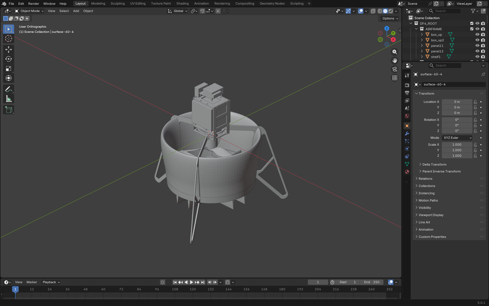
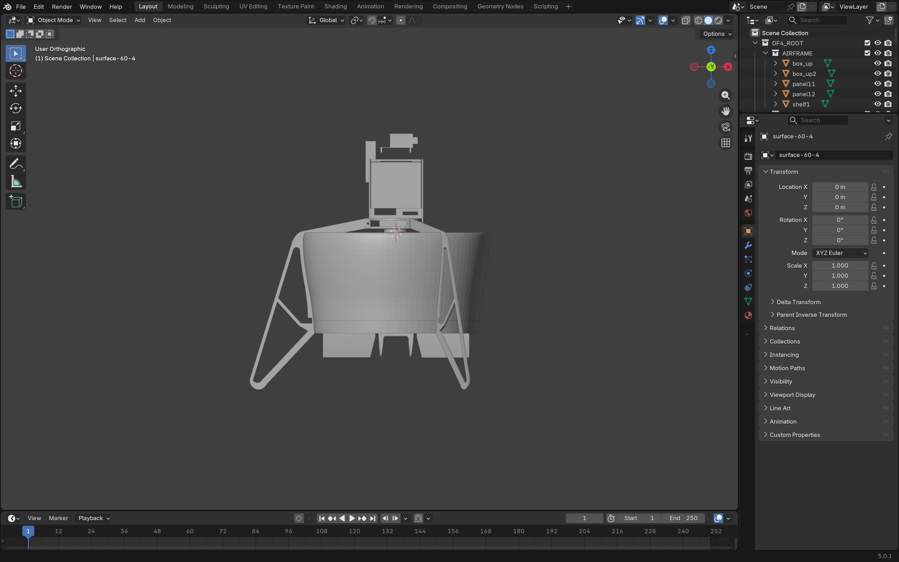
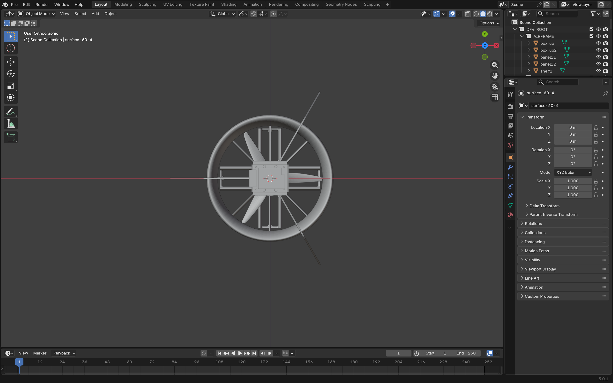
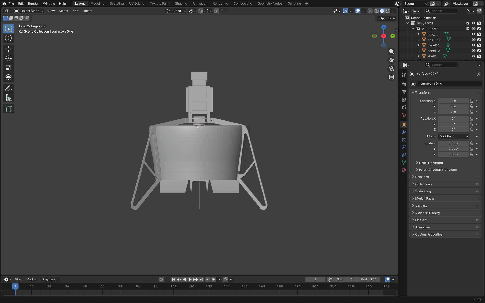
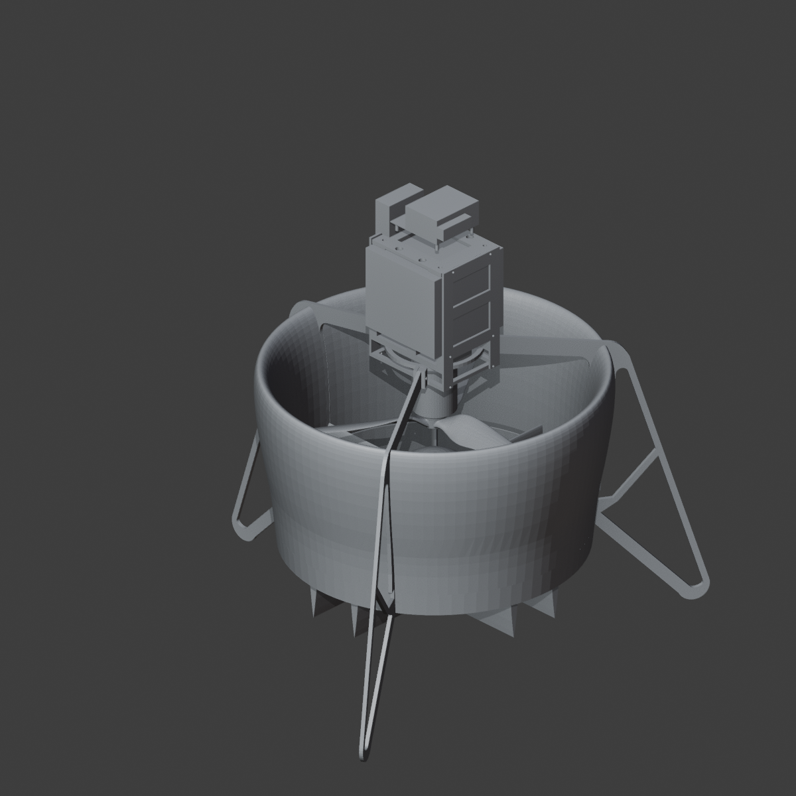

# Stage 1 — 通用模型导入与空间装配恢复

| 项目 | 内容 |
|---|---|
| 阶段 | Stage 1 |
| 验证机型 | DF4（ducted-fan UAV） |
| 阶段状态 | 已完成并通过本地验收；等待外部复核 |
| 开发仓库 | <https://github.com/tangqingxi/AeroViz-Blender> |
| 开发提交 | `7df632edfc1f1320bc0b270cb22d3e73e2e6dc81`（`main`，已推送；相对交付 Stage 1/1.5 时的 `d956bec…` 只有文档变更，代码与配置未变） |
| 审计仓库 | <https://github.com/tangqingxi/AeroViz-Blender-Audit> |
| 原始执行日期 | 2026-11-10 |
| 报告整理日期 | 2026-11-10 |
| 证据清单 | [`evidence-manifest.json`](evidence-manifest.json) |

---

## 1. 阶段目标

1. 建立**配置驱动**的通用导入管线：机型差异只体现在配置文件，通用代码中不出现任何 DF4 专用名称或路径。
2. 从单模型 SDF 描述与 33 个 STL 网格中恢复**真实装配位置**：link pose × visual pose、mesh scale、标题显式 frame、`relative_to` 引用，全部按 SDFormat 语义求值。
3. 保留**关节骨架**（关节中心、轴、限位、父子层级）为后续运动学阶段提供基础，但本阶段**不创建任何动画**。
4. 建立可核验的交付物：`.blend` 工程、四向预览、逐件世界矩阵记录、原始输入 SHA-256 清单、真实图形进程的打开验收与截图。
5. 对几何完整性做**审计式处理**：重复件、合并件必须被证明可隐藏（三角面覆盖率 100 %），不得静默丢弃任何 STL。

本阶段明确**不包含**：材质美化（属 Stage 1.5）、机械运动、爆炸视图、镜头与视频渲染、动力学或干涉校验。

## 2. 执行环境

| 项目 | 值 |
|---|---|
| 操作系统 | Windows 11 家庭中文版，10.0.26200（Build 26200） |
| CPU / 内存 | Intel Core i7-14650HX（16 核 / 24 线程）/ 15.6 GB |
| GPU | NVIDIA GeForce RTX 5060 Laptop GPU；Intel UHD Graphics；ToDesk 虚拟显示器 |
| Blender | 5.0.1，build hash `a3db93c5b259`，构建日期 2025-12-16 |
| Blender 内置 Python | 3.11.13 |
| 额外 Python 包 | 无（仅使用 Blender 自带模块：`bpy`、`mathutils`、`bmesh` 相关 API 与标准库） |
| Blender 可执行文件 | `D:\app\Blender\blender.exe` |
| 开发工作区 | `D:\01_科研\TIE\DF4_SolidWorks\Blender` |
| 模型输入目录（只读） | `D:\01_科研\TIE\DF4_SolidWorks\DF4_SolidWorks` |

## 3. 实现内容

本阶段产出的代码现位于开发仓库的 `adapters/`、`scripts/` 与 `configs/`：

| 组件 | 职责 |
|---|---|
| `configs/DF4.json` | 机型的全部专属数据：输入根目录、单位、URI 映射、分组、参考件、补充零件、尺寸区间、坐标与单位依据 |
| `configs/template.json` | 新机型模板，含 STL 独立零件示例 |
| `adapters/__init__.py` | 格式适配器注册表（`sdf` / `stl`），格式接入的唯一切换点 |
| `adapters/import_sdf.py` | 单模型 SDF 解析：`link`/`visual`/`joint`/`frame` 位姿、弧度 RPY、`expressed_in`、`relative_to`、`model://` URI 映射、外部 include 记账 |
| `adapters/import_stl.py` | Blender 原生 STL 导入，按声明的 `m`/`mm`/`cm` 缩放，保持源坐标 |
| `scripts/scene_builder.py` | Collection 分组、`LINK::`/`JOINT::` 空对象、父子层级、四向正交预览 |
| `scripts/validation.py` | 输入快照、逐件边界、几何重复审计、参考件覆盖率、报告生成 |
| `scripts/gui_verify.py` | 真实图形进程重开工程、核对数据、切换四视角并截图 |
| `scripts/check_joint_hierarchy.py` | 独立后台进程验证关节传递，不保存旋转 |

关键实现决策（均有代码强制，不依赖人工纪律）：

- **输入只读且被证明未被修改。** 构建前后各做一次逐文件 SHA-256 快照，任何字节差异都中止构建。
- **输出边界。** 输出路径必须位于仓库工作区内，且不得与输入目录相互包含。
- **不静默丢弃网格。** 输入目录下每个 STL 必须被描述文件引用、列入 `extra_meshes`、或列入 `reference_only` 并给出理由；否则报错。
- **隐藏件必须可证明冗余。** 参考件的**不同三角面**须被可见零件 100 % 覆盖（1e-6 精度）才允许隐藏。
- **不猜测坐标。** 关闭 `apply_model_pose`，保留模型坐标原点，不应用 SDF 中的 0.5 m 仿真高度。
- **位姿误差校验。** 每个对象构建后与目标世界矩阵逐元素比较，误差 > 1e-6 即报错；显式重置 `matrix_parent_inverse` 以避免父子累积漂移。
- **显式拒绝而非静默近似**：`degrees="true"`、四元数位姿、嵌套模型、一个 link 多个父关节、非网格 visual 一律报错。

## 4. 验收结果

| # | 验收项 | 判据 | 结果 |
|---|---|---|---|
| 1 | STL 全覆盖 | 输入 33 个 STL 全部导入 | 通过（33/33） |
| 2 | 独立对象 | 每个 STL 一个独立 Mesh Object | 通过（33 个独立对象） |
| 3 | 可见 / 隐藏划分 | 27 可见 + 6 隐藏参考件 | 通过 |
| 4 | 参考件三角面覆盖 | 每个隐藏件独特三角面被覆盖 ≥ 99.999 % | 通过（6 个均为 100.00 %） |
| 5 | 重复件识别 | 微米精度识别完全相同的几何 | 通过（5 对） |
| 6 | 世界矩阵 | 与描述文件目标矩阵误差 ≤ 1e-6 | 通过（最大误差 0.0） |
| 7 | 整机尺寸 | 落在 `expected_dimensions_m` 区间内 | 通过 |
| 8 | 原始输入完整性 | 构建前后 34 个文件 SHA-256 完全一致 | 通过 |
| 9 | 骨架计数 | 26 个 `LINK::` 与 26 个 `JOINT::` 空对象（实际 25 个关节） | 通过（26 link / 25 joint） |
| 10 | 关节传递 | 带网格的 revolute 关节旋转时仅后代网格随动、关节中心不变 | 通过（5 个关节，最大误差 0） |
| 11 | 无动画残留 | 工程中不存在 `animation_data` | 通过（0 个对象） |
| 12 | 图形进程重开 | 真实图形窗口（`background=false`）打开，33 个网格存在且矩阵误差 < 1e-6 | 通过（误差 0.0） |
| 13 | 视觉检查 | 逐一查看四方向截图，无整体错位、无散落零件 | 通过（人工查看，见 §7） |
| 14 | 交付字节复验（2026-11-10） | 只读重开当前 `.blend`，重放上述断言 | 通过（`REVERIFY_OK`） |

第 14 项为报告整理当日新增：因工程文件在图形会话退出时被 Blender 重新保存（见 §9 第 1 条），需要对**磁盘上最终字节**重新核对，结果见 `manifests/reverify-2026-11-10.json`。

## 5. 关键技术参数

### 单位与坐标依据

- STL 无单位元数据。原始几何跨度约 0.38，SDF `mesh scale=1`，碰撞盒 0.30 × 0.30 × 0.47 m —— 据此判定网格单位为**米**。
- Blender 使用 METRIC，`scale_length = 1`；X/Y 保持源文件方向，Z 向上。
- 本模型所有 link/visual 放置矩阵均为单位阵，STL 自身已带非零装配范围，惯性质心与对应几何相符 —— 因此**保留源坐标，不重复平移**。
- 源文件未定义飞行前向，故不自行旋转：正视沿 −Y 看向 +Y，侧视从 +X 看向 −X。
- `apply_model_pose = false`；模型位姿 `[0, 0, 0.5, 0, 0, 0]` 仅记录不使用。
- Link pose 相对模型；Visual pose 相对 link；Joint pose 默认相对 child link；inertial pose 只作元数据保存。

### 几何

| 项目 | 值 |
|---|---|
| 原始 STL 数量 | 33（另有 1 个 SDF 描述文件，输入共 34 个文件） |
| 网格对象 | 33 |
| 默认可见 / 隐藏参考 | 27 / 6 |
| 整机可见包围盒 | 0.353281 × 0.375610 × 0.377624 m |
| 最小坐标 | (−0.2159924656, −0.1877549589, −0.2317739725) m |
| 最大坐标 | (0.1372880936, 0.1878549606, 0.1458495557) m |

### 功能分组（对象数）

| 分组 | 数量 | 分组 | 数量 |
|---|---|---|---|
| AIRFRAME | 6 | CONTROL_SURFACES | 8 |
| DUCT | 4 | ROTOR | 2 |
| TAIL | 3 | MOTOR | 1 |
| ELECTRONICS | 5 | SERVOS | 4 |

### 重复与合并件

| 参考件 | 与之相同的可见件 | 结论 |
|---|---|---|
| `base.STL` | —（合并件） | 独特三角面被可见零件覆盖 100.00 % |
| `rotor-iFlight-9inch.STL` | `rotor.STL` | 全部三角面在微米精度一致 |
| `surface-60-1.STL` | `cs33.STL` | 全部三角面在微米精度一致 |
| `surface-60-2.STL` | `cs2.STL` | 全部三角面在微米精度一致 |
| `surface-60-3.STL` | `cs11.STL` | 全部三角面在微米精度一致 |
| `surface-60-4.STL` | `cs4.STL` | 全部三角面在微米精度一致 |

### 关节骨架

共 25 个关节空对象：19 个 `fixed`（`JOINT_0` … `JOINT_18`）、5 个带网格的 `revolute`（`cs1_joint` … `cs4_joint`、`rotor_joint`）、1 个无网格的 `revolute`（`ductedfan4/imu_joint`）。

| 关节 | 父 → 子 | 类型 | 关节中心（m） | 模型坐标轴 | 限位（rad） |
|---|---|---|---|---|---|
| `cs1_joint` | base_link → cs1 | revolute | (0, 0, −0.140995) | (1, 0, 0) | −0.3491 ~ 0.3491 |
| `cs2_joint` | base_link → cs2 | revolute | (0, 0, −0.140995) | (0, 1, 0) | −0.3491 ~ 0.3491 |
| `cs3_joint` | base_link → cs3 | revolute | (0, 0, −0.140995) | (1, 0, 0) | −0.3491 ~ 0.3491 |
| `cs4_joint` | base_link → cs4 | revolute | (0, 0, −0.140995) | (0, 1, 0) | −0.3491 ~ 0.3491 |
| `rotor_joint` | base_link → rotor | revolute | (0, 0, −0.045000) | (0, 0, 1) | −1e16 ~ 1e16（连续） |
| `ductedfan4/imu_joint` | base_link → ductedfan4/imu_link | revolute | (0, 0, 0) | (1, 0, 0) | 0 ~ 0 |

19 个 fixed 关节（`JOINT_0`…`JOINT_18`）中心均为 (0, 0, 0)，轴 (0, 0, 1)，无限位。关节的 `type`、`child`、`parent`、`axis`、`axis_model`、`lower`、`upper` 均写入空对象自定义属性。

## 6. 测试结果

### 6.1 原始执行（2026-11-10）

| # | 命令 | 期望输出 | 实际 |
|---|---|---|---|
| 1 | `blender --background --factory-startup --python-exit-code 1 --python scripts/main.py -- --config configs/DF4.json` | `STAGE1_IMPORT_OK <path>` | 通过（`build.log`） |
| 2 | `blender -W output/DF4/DF4_Stage1.blend --python scripts/gui_verify.py` | 四张 `gui_*.png` + `gui_validation.json`，`background=false` | 通过（`gui_validation.json`：33 网格、误差 0.0） |
| 3 | `blender --background … --python scripts/check_joint_hierarchy.py` | `JOINT_HIERARCHY_OK 5` | 通过（`joint_checks.log`） |

图形进程日志记录：`Read blend: …DF4_Stage1.blend` → 28 分 39 秒后 `Saved "DF4_Stage1.blend"` → `Blender quit`（见 §9 第 1 条）。

### 6.2 整理当日复核（2026-11-10）

| # | 命令 | 结果 |
|---|---|---|
| 4 | `blender --background … --python tests/reverify_saved_project.py -- --config configs/DF4.json` | `REVERIFY_OK`：33 网格 / 27 可见 / 6 参考 / 26 link / 25 joint / 89 对象；矩阵误差 0.0；包围盒误差 1.49e-08；无动画数据 |
| 5 | Blender 后台运行适配器等价性检查（一次性迁移校验，记录见 [`../../manifests/refactor-check-2026-11-10.json`](../../manifests/refactor-check-2026-11-10.json)） | 适配器重构后重新解析 DF4：25 个 visual 部件、26 个 link、25 个 joint、1 个 include、1 个跳过关节；材质记录 25 条（25 条带定义）；预计网格对象 33 个 —— 与 Stage 1/1.5 已记录的基线全部一致 |

包围盒 1.49e-08 的差异来自记录方式不同：Stage 1 记录用对象包围盒角点，复核用网格顶点坐标，两者在 1e-8 量级一致，不构成尺寸变化。

## 7. 关键截图

以下四张是在**真实 Blender 图形进程**中重开工程后，用 Blender 自带窗口截图功能捕获的（`bpy.ops.screen.screenshot`），不是离线渲染：

另一张是 Stage 1 的离线四向工作台预览（`BLENDER_WORKBENCH`，中性单色显示，无材质），用于结构判读：

两类文件用途不同，不混用：`gui_*.png` 是窗口截图（验收证据），`isometric/front/top/side.png` 是离线渲染（结构参考）。

## 8. 产物路径及 SHA256

路径相对开发工作区根目录。审计仓库中的证据副本为逐字节拷贝，哈希相同。

| 文件 | 大小 (B) | SHA256 | 开发工作区路径 |
|---|---|---|---|
| Stage 1 工程（当前字节） | 5397145 | `10caf87e82d5072801f4cdf10c1a3690696a1b60d94012cfecbc12403048bc8d` | `output/DF4/DF4_Stage1.blend` |
| Stage 1 工程（前一次保存，被 Stage 1.5 引用） | 5389699 | `574c1b0071c923f0513e41430c7c7d7b6c6ea5b62c24ddb0cae04d2c87d9afeb` | `output/DF4/DF4_Stage1.blend1` |
| 离线工作台预览 等轴测 | 1102914 | `37825b6b727c91da6e9730ee27931e7f91686aba01027f763471fc4702bd15f1` | `output/DF4/preview/isometric.png` 审计副本：`stages/stage-1/evidence/isometric.png` |
| 离线工作台预览 正视 | 1028845 | `636f9b3ae2e354301986749bdcc97cb2702f3bb11a93c663ddf3cf224c2726e0` | `output/DF4/preview/front.png` |
| 离线工作台预览 俯视 | 992782 | `dbfd5eabf1e09e57acaabb410212f0e96f5c70f8be06110616b3a4d2cbc6306c` | `output/DF4/preview/top.png` |
| 离线工作台预览 侧视 | 1035857 | `02f843038f60542c966d630a93926197d713125d961ad941eb1d1aca912cc907` | `output/DF4/preview/side.png` |
| 图形窗口截图 等轴测 | 492291 | `c58c247d3d9f2871d84f7727a3d5a5177b3efb3573c15b1741808f02ba677900` | `output/DF4/preview/gui_isometric.png` 审计副本：`stages/stage-1/evidence/gui_isometric.png` |
| 图形窗口截图 正视 | 348922 | `02b0a985521a33d34f2469df696fb2cca573a28db4c587d62c81669f350c5e49` | `output/DF4/preview/gui_front.png` 审计副本：`stages/stage-1/evidence/gui_front.png` |
| 图形窗口截图 俯视 | 423399 | `f5a8cd1d1efade2ddd5fdb95cf6367ddb6bc1d1460e7deb773dbc079cbc359a6` | `output/DF4/preview/gui_top.png` 审计副本：`stages/stage-1/evidence/gui_top.png` |
| 图形窗口截图 侧视 | 357002 | `d07924ba686b8bd9ee031135336b2dd467d83c041744646d30093a27b295c874` | `output/DF4/preview/gui_side.png` 审计副本：`stages/stage-1/evidence/gui_side.png` |
| 导入记录与逐件矩阵 | 36704 | `8071079305f3752c0d37e71fa432455e6e4bd8c6ea9575f56c97fccdc2ea16ee` | `output/DF4/reports/validation.json` 审计副本：`stages/stage-1/evidence/validation.json` |
| 图形进程复验记录 | 8076 | `168a02f87572082ca50b94468e29f88660e2c41512c35befd9c35e28fecee1b3` | `output/DF4/reports/gui_validation.json` 审计副本：`stages/stage-1/evidence/gui_validation.json` |
| 关节传递检查记录 | 919 | `58b1a4ecb4c2f50196b40aa38d4eee1764dcb556f749d7af1ae5fabffce898fb` | `output/DF4/reports/joint_checks.json` 审计副本：`stages/stage-1/evidence/joint_checks.json` |
| 原始输入 SHA256 清单 | 4794 | `70cfbf9c662f4079ffd77adfea1386f73c4b923dba1db496ea90fef49e4f7c0e` | `output/DF4/reports/input_manifest.json` 审计副本：`stages/stage-1/evidence/input_manifest.json` |
| 构建日志 | 1809 | `b6feb4ca3f47cba3a1046271883005a66b5bf1da564b8f78abd58cfc51828ff2` | `output/DF4/reports/build.log` |

34 个原始输入文件的逐件 SHA-256 见 [`../../manifests/ARTIFACT_MANIFEST.md`](../../manifests/ARTIFACT_MANIFEST.md) 与 [`evidence/input_manifest.json`](evidence/input_manifest.json)。

## 9. 未解决问题

1. **工程文件在验收截图之后被重新保存。** 图形进程日志显示，Stage 1 会诊会话在关闭时被 Blender 执行了 `Saved "DF4_Stage1.blend"`（进程运行 28 分 39 秒后）。因此磁盘上当前的 `.blend` 字节与截图时刻的字节不是同一份，且本地没有更早的字节归档。当前字节已通过只读复验重新对齐全部断言（§6.2 第 4 项），但"截图时刻的原始字节"无法再独立提供 —— 后续阶段应约定：验收脚本退出时不保存工程，或保存后重新截图。

2. **Stage 1.5 的输入版本与当前 Stage 1 文件不同。** Stage 1.5 记录的被保护工程哈希 `574c1b00…` 现在对应 `DF4_Stage1.blend1`（前一次保存），当前 `DF4_Stage1.blend` 为 `10caf87e…`。即 Stage 1.5 是从 `.blend1` 那一版派生的，这一因果关系已在本报告中明确，而不是"两者一致"。

3. **两个补充零件缺少描述文件依据。** `controller2.STL` 与 `X-tend.STL` 未被 SDF 引用，只能沿用 STL 原始坐标挂在模型根下；其型号与固定关系未经描述文件证实（配置中已有 `reason` 记录）。

4. **外部 include 未建模。** `gps0`（`model://gps`）是外部 Gazebo GPS 传感器，本地无网格，已在 `ignored_includes` 中显式记录并跳过关节 `gps0_joint`；不虚构该对象。

5. **`ductedfan4/imu_joint` 为限位 0~0 的 revolute 关节**，且没有网格子代，几何上无可见作用，仅保留为元数据。

6. **本地描述文件与上游不一致。** 本地 `ductedfan4.sdf.jinja`（46 482 B）与 `mengchaoheng/DF_gazebo` 分支 `ductedfan` 上同名文件（38 859 B）字节不同，本地副本含 PX4/MAVLink 侧改造；上游仓库没有许可证文件，几何本体因此不入库 —— 详见 [`../../manifests/ARTIFACT_MANIFEST.md`](../../manifests/ARTIFACT_MANIFEST.md) §6 与开发仓库 `docs/asset-provenance.md`。

7. **源文件未定义飞行前向**，X/Y 方向完全沿用源坐标；若后续镜头阶段需要"机头朝向"，必须另行确认，不能由本阶段推断。

8. **本阶段检查不等同于**制造公差、碰撞干涉或动力学验证。

## 10. 下一阶段交接信息

本阶段的直接后续工作 **Stage 1.5（SDF 材质恢复）已完成**，见 [`../stage-1.5/STAGE_1_5_REPORT.md`](../stage-1.5/STAGE_1_5_REPORT.md)。

**下一个未执行阶段是 Stage 2（机械运动骨架与独立运动测试），尚未获授权，不得自行开始。**

Stage 2 可直接使用的既有基础：

- `JOINT::<name>` 空对象 25 个，携带 `type`、`child`、`parent`、`axis`、`axis_model`、`lower`、`upper`；其中 5 个带网格子代，已验证旋转时只有其后代随动、关节中心不变。
- 舵面限位 ±0.3491 rad（±20°），旋翼为连续转动。
- 图形验收脚本、关节传递检查脚本、只读复验脚本均已就绪并可复用。
- 输入目录保持只读，`output/` 为唯一写入区。

Stage 2 若开始，建议的验收门槛（待授权时确认）：每个运动关节的旋转不越界、非后代对象零位移、工程不覆盖 Stage 1/1.5 版本、并新增独立的运动测试记录。
