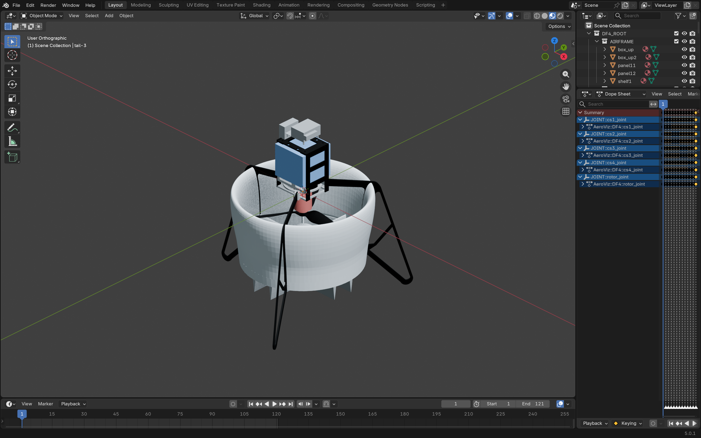
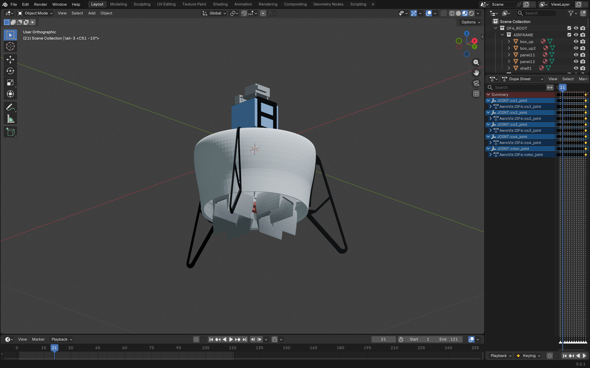
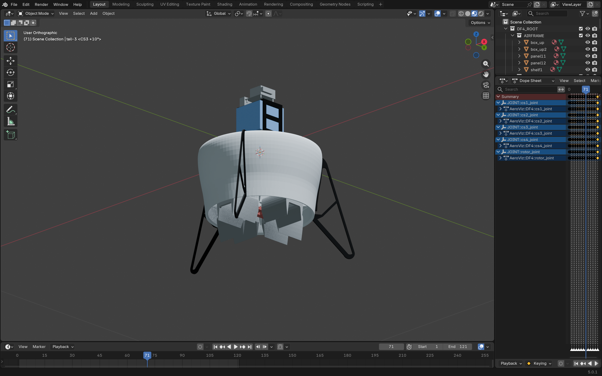
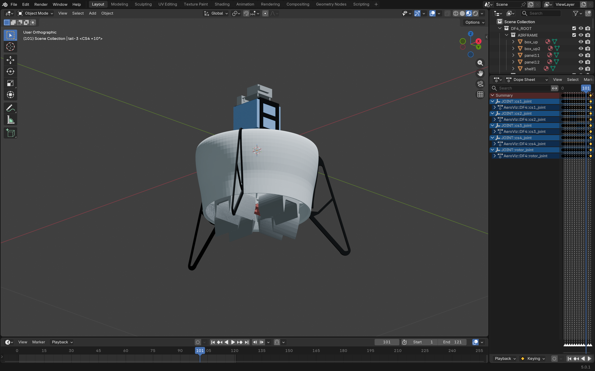
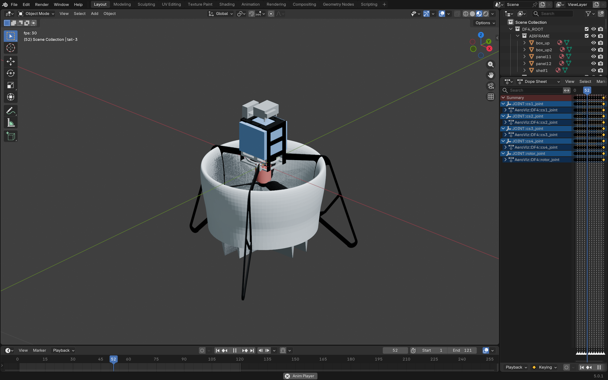

# Stage 2 — 机械运动骨架与独立运动测试

**STAGE 2: PASS**

- DEV：`16f89e2c173bf5a414f8432e77c8d6744216abba`。
- Blender：5.0.1，原生 Action layers/strips/channelbag API。
- 输入基线：`216ae8ab7de87cac17846a304dcd34110008ef4a71ce77f1829c9a8a37c0e474`。
- 当前唯一工程：`output/DF4/DF4.blend`，5414501 B。
- 最终 SHA256：`c206c5daf61c182982101bdbe8bd797fe0ea47e52dd5855989f16c2f84d8873b`。
- Stage 3: WAITING FOR AUTHORIZATION。

## 1. 实现与边界

新增 `scripts/animation/kinematics.py`、`scripts/animation/gui_verify.py` 和 `tests/test_kinematics.py`，参数在 `configs/DF4.json`。核心无 DF4 关节名、零件名、旋转轴或演示速度常量。复用五个现有 JOINT 对象，每个独立 Action；没有导入网格、重建关节、增加对象、修改层级、重做材质或制作爆炸/视频。

材料历史保护函数只增设显式动画白名单：仅五个授权关节的 `has_animation` 可改变，其他历史字段仍严格相等。历史几何、包围盒、矩阵、材质和 89 个原对象检查没有删除。当前整机 93 个对象均再次对照原始结构基线。

## 2. 原始 SDF / 保存工程的关节参数

重新读取本地 SDF 并与工程实际自定义属性比较，五个关节无差异（中心按 1e-6 m 比较）。正方向与右手定则保持一致，没有反转轴来修正外观。中心表用 SDF 模型坐标表示：

| 关节 | 原始模型轴 | 原始中心 m | 子网格 | 原始限位 rad |
|---|---|---|---|---|
| rotor_joint | +Z | (0,0,-0.045) | rotor | -1e16 ~ +1e16 |
| cs1_joint | +X | (0,0,-0.140995) | cs11 | -0.3491 ~ +0.3491 |
| cs2_joint | +Y | (0,0,-0.140995) | cs2 | -0.3491 ~ +0.3491 |
| cs3_joint | +X | (0,0,-0.140995) | cs33 | -0.3491 ~ +0.3491 |
| cs4_joint | +Y | (0,0,-0.140995) | cs4 | -0.3491 ~ +0.3491 |

IMU 的零限位和无网格子代状态保持原样，固定关节、网格、相机、展示灯均无动画数据。轴从模型根纯旋转到世界，再通过关节纯旋转的逆变换到局部；反向变换按有符号方向检查。记录见 [independent_motion.json](evidence/independent_motion.json)，包括实际单精度中心值。

q(t)=q0×q_delta(local_axis,angle)，保留初始姿态。另有非单位 q0 与已旋转模型根的数学用例，以及非均匀缩放拒绝用例。当前模型缩放正常；引擎对负/非均匀缩放、剪切和受控关节级联明确拒绝，不默默近似。

## 3. 本阶段配置的演示参数

30 FPS；Frame 1–121；四秒跨度；LINEAR。旋翼速度 1200°/s，累计 4800°，每整数帧 +40°。**这是可配置视觉演示参数，不是实测电机转速，也不是动力学或物理仿真结果。**

| 舵面 | 角度关键点 | 末尾 |
|---|---|---|
| CS1 | 1:0° → 11:+10° → 21:-10° → 31:0° | 121:0° |
| CS2 | 1:0°、31:0° → 41:+10° → 51:-10° → 61:0° | 121:0° |
| CS3 | 1:0°、61:0° → 71:+10° → 81:-10° → 91:0° | 121:0° |
| CS4 | 1:0°、91:0° → 101:+10° → 111:-10° → 121:0° | 121:0° |

12 个 Timeline Markers 标明正偏、负偏和 Return。各舵面只在自己的时间段运动，其他三个零位；旋翼贯穿全时间轴。

旋翼和舵面均先按角度曲线逐整数帧求样，再生成四元数关键帧，避免仅对端点四元数作分量插值时角度偏离预期。每个 Action 有四个通道，每通道 121 点，Quaternion 符号连续。半角先用双精度 sin/cos 求值，再存 Blender 单精度；参考矩阵单独用双精度 Rodrigues 计算，避免大累计角提前单精度化。

## 4. 独立运动与组合验证结果

五个关节先在静态原字节副本中分别测试，之后才创建组合动画。舵面施加 +10°、-10°、恢复0°；旋翼 +90° 后恢复。每次记录目标与非目标网格矩阵、关节中心、局部四元数，并与独立的世界轴旋转矩阵比较。

- 五个独立试验全部 PASS；目标网格确实移动，非目标不动；全部对象归零后恢复原世界矩阵，几何与材质快照一致。
- 组合逐帧检查 1–121 的真实依赖图求值，不只检查关键帧是否存在。
- Frame 1 保持原装配，原有对象结构、材质和几何全部保留。
- 每帧关节中心最大漂移：0 m。
- 所有对象对参考世界矩阵的最大元素误差：3.57627869e-07，小于 1e-6。
- 非目标对象最大矩阵误差：0。
- 旋翼每帧增量相对40°的最大误差：1.89035293e-06°，小于 1e-4°。
- 有符号增量累计：4800.000025901°，累计误差约 0.000026°；不是只看末帧模360°姿态。
- 93 对象 / 33 网格 / 7 材质 / 33 分配不变；恰好五个 JOINT 有动画，其他88个对象无动画。

| 整数帧 | 配置累计旋翼角 | 舵面状态 |
|---|---|---|
| 1 | 0° | 全部零位 |
| 31 | 1200° | 全部零位 |
| 61 | 2400° | 全部零位 |
| 91 | 3600° | 全部零位 |
| 121 | 4800° | 全部零位 |

详细证据：[独立运动](evidence/independent_motion.json)、[旋翼连续性](evidence/rotor_continuity.json)、[121帧组合检查](evidence/combined_animation.json)、[结构基线](evidence/structure_baseline.json)、[保存后回归](evidence/final-regression.json)。

## 5. 正式工程更新与保存

开始前 fetch 两仓库，工作区 clean，本地/远端 HEAD 对齐，原始 `reverify_saved_project.py` 通过。原件字节备份位于 `.work/stage-2/rollback/DF4.blend`；测试工程与全部中间结果只位于 `.work/stage-2/`。

副本独立试验、组合检查、独立进程重开和历史回归通过后，重新打开仍匹配原始 SHA256 的正式工程，使用同一引擎生成、验证，再经 `project_io.save_project()` 原子保存。新进程再次重开并逐帧验证与执行历史回归，PASS。持久化测试入口的 apply 阶段也包含保存后子进程回归与失败字节恢复逻辑，事务成功分支已在副本验证；本轮未触发正式工程恢复，也不声称做了新的故障注入试验。

本地最终只有 `output/DF4/DF4.blend`，无阶段编号工程、preview/reports 或 .blend1。成功证据提交后清理 `.work/stage-2/`，不上传原件、回滚副本、STL、SDF 或测试工程。

## 6. 实际 Blender 图形窗口验收

真实 Blender 5.0.1 打开最终工程，Timeline 范围1–121，Dope Sheet 中五个独立 Action 可见。采用 Blender 原生 `screen.animation_play`（与空格绑定的同一操作），未使用 computer-use 或物理按键注入。播放期间不通过脚本设帧，连续观察到 29 个实际帧状态、约 6.06 s，跨过一次完整循环；截图中播放状态与 fps 显示可见。

实际播放及六种窗口截图已查看：旋翼姿态推进、舵面顺序偏转，无部件脱离或明显错位。截图是 `screen.screenshot` 的真实窗口，不是离线渲染。验收后暂停在第1帧，保留完整工程窗口，GUI 没有保存文件，磁盘 SHA256 未变。证据：[gui_validation.json](evidence/gui_validation.json)。













## 7. 复现、限制与交接

代码、配置与测试 SHA256 见 [stage2_validation.json](evidence/stage2_validation.json)。`tests/test_kinematics.py` 提供 prepare/apply/verify 三阶段；GUI 入口见 DEV README。当前工程只读重验：

```powershell
& $B --background --factory-startup --python-exit-code 1 `
  --python tests/reverify_saved_project.py -- --config configs/DF4.json
```

证据清单使用 DEV `scripts/verify_evidence.py` 校验。Stage 1/1.5 的历史字节、来源和坐标不确定性未改写。没有未解决的本阶段验收失败；技术范围为机械姿态与整数帧运动学，不包括制造干涉、气动力、驱动扭矩或物理仿真。分量 LINEAR 的帧间归一化四元数不保证子帧严格匀角速；每个整数帧均已严格验证。

**Stage 2: COMPLETE**

**Stage 3: WAITING FOR AUTHORIZATION**
