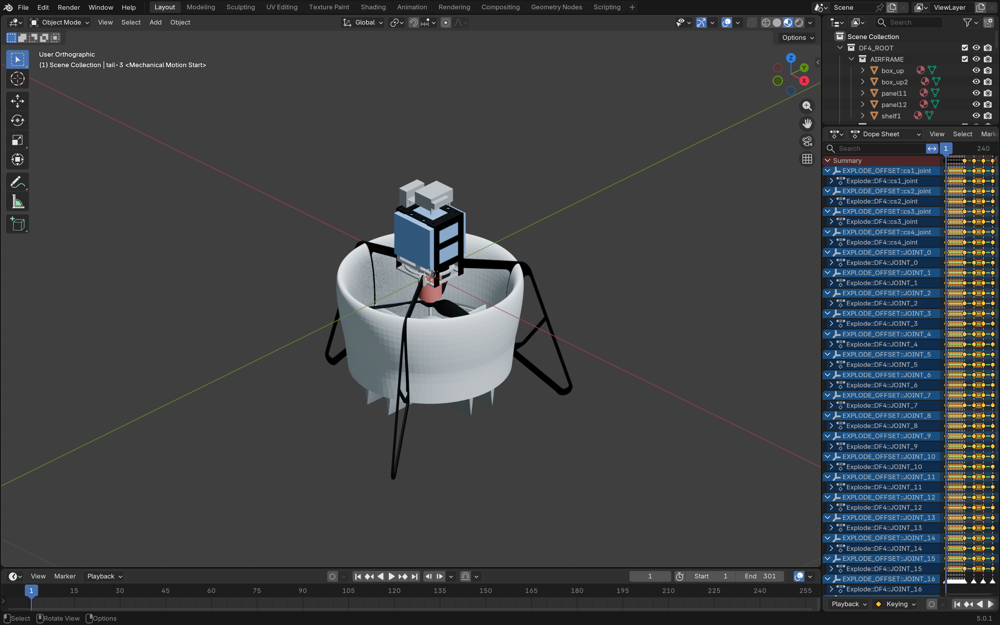
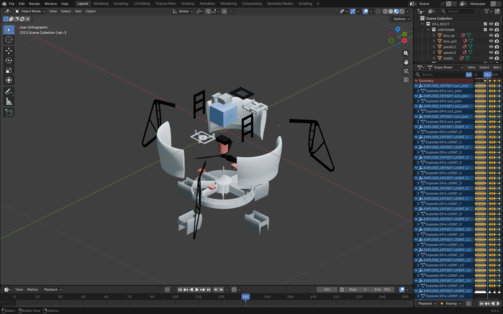
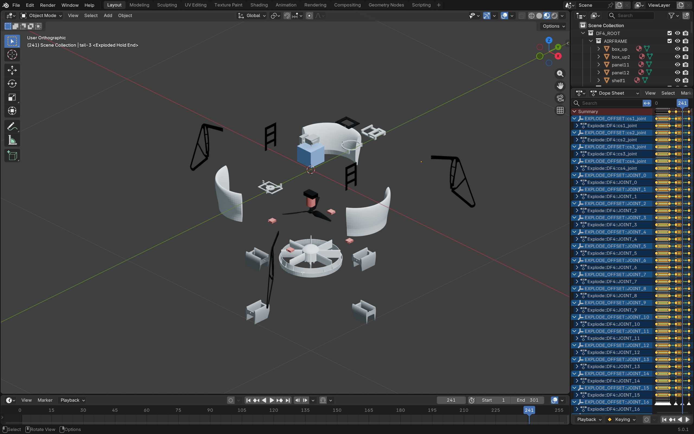
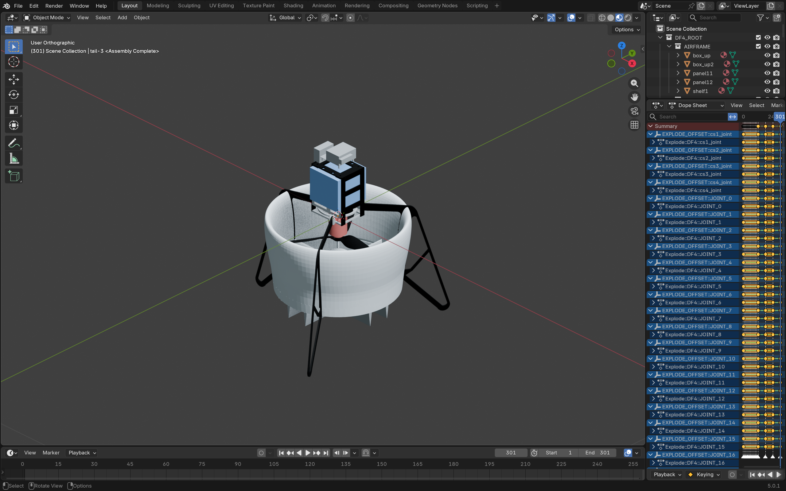

# Stage 3 — 坐标系定义与爆炸视图

**STAGE 3: PASS**

- DEV：`6b2480bc6683de6a2d94fb23b20683c04f8bc17d`。
- Blender：5.0.1。
- 唯一正式工程：`output/DF4/DF4.blend`，5422781 B。
- 当前SHA256：`392af12f14a6fbfb27b201d836b86752c90a97afbc024960fc00f03407726824`。
- 已按用户最新要求在真实窗口截图验收后退出Blender，不要求用户操作软件。
- Stage 4: WAITING FOR AUTHORIZATION；未输出MP4或开展相机/灯光编排。

## 1. 基线接受与历史保护

任务初始指定Stage2交付哈希为 `c206c5daf61c182982101bdbe8bd797fe0ea47e52dd5855989f16c2f84d8873b`。实际当前文件为 `5e96e2af3f88d7f5bedc8b9041b6404b039c851c8c089517c995b675222b5943`，保存于Frame11；已有DF4.blend1恰好匹配历史哈希并保存于Frame1。

用户明确选择接受当前文件作为Stage3新基线，不为匹配历史SHA而回退。完成比较后才备份新基线至 `.work/stage-3/rollback/DF4.blend`，并按用户授权删除多余.blend1。历史Stage2报告、交付哈希和证据未改写。

完整语义比较PASS，覆盖：对象层级/矩阵/Collection/隐藏状态、网格坐标/法线/边/拓扑/材质索引/平滑属性、材质签名/槽位/节点/连接、关节自定义属性、五个Action的关键帧/句柄/插值/外推/属性、Timeline Markers，以及两份文件1–121帧逐对象矩阵。未检出影响Stage2成果的实质差异。证据：[semantic_comparison.json](evidence/semantic_comparison.json)。两仓库执行前fetch后与已知main一致且clean。

## 2. 冻结的模型坐标与PX4向量转换

模型FLU为本次用户授权的正式定义，不是本阶段实机测量结果：

| 坐标轴 | 语义 |
|---|---|
| +X | 前方 |
| +Y | 左侧 |
| +Z | 上方 |

右手系；Blender世界与模型FLU当前对齐。DF4_ROOT和LINK::base_link保持单位世界矩阵，原始模型没有整体旋转。原点是SDF模型原点，与base_link初始原点重合，**不标注为实机CG**。

FRD为前/右/下。`R_FLU_FROM_FRD = R_FRD_FROM_FLU = diag(1,-1,-1)`：绕X旋转180°，det=+1、正交、逆等于自身。三个单位基分别得到+X、-Y、-Z；正交性、单位基、往返误差均为0，满足1e-7阈值。反射矩阵拒绝测试也通过。

`coordinate_frames.py`是通用模块，无DF4名称/专属矩阵常量；定义在配置，元数据写入根对象。只读验证不会通过重写元数据掩盖缺失或错误。全部原对象矩阵在坐标测试前后保持一致。向量旋转不等于绝对位置或原点平移转换，本轮不处理NED地理坐标。

Autopilot两个C++路径按任务给定作为对照来源；当前可访问工作区未取得对应源码，**未声称独立核对其具体实现或提交**。本轮采用用户给定的冻结定义，并完成数学和实际工程验证。详见DEV `docs/coordinate-frames.md` 与 [coordinate_tests.json](evidence/coordinate_tests.json)。

## 3. 原机械层级与独立位移层

正式执行前重新核对25个JOINT，其中24个有网格子代，均直接以LINK::base_link为父级且子树与Stage2一致。唯一无网格IMU不纳入。

新增EXPLODED_RIG Collection和24个独立Empty：

```text
原LINK父级 → EXPLODE_OFFSET::<joint_name> → 原JOINT → 原子LINK → 原网格
```

控制器初始父级原点、单位旋转/缩放/父逆矩阵；只改变配置明确列出的24个JOINT直接父级。JOINT原局部姿态、父逆矩阵及世界矩阵保持，原网格父级不变。构建前后原五个Action内存身份不变，保存后关键帧/句柄/插值/外推/属性完整指纹一致，未删除或重做机械动画。

直接电池、controller2、X-tend、REFERENCE_ONLY参考件及IMU保持原位置和原状态；没有用分组制造未经SDF证实的连接。原Collection、33网格、7材质及33分配、相机和灯光保持。

## 4. 本阶段人为配置的爆炸位移

先依据实际分支包围盒/中心确定原径向与轴向，再按结构和视口检查选择间距。中心部件采用明确的分层/侧向退出方案：电机向下避免穿过固定电池，盒体水平向两侧撤出，底板以侧移为主再少量抬升。下表是展示位移，**不是实测拆装行程、连接关系或物理仿真结果**。

全部向量在DF4_MODEL_FLU定义，经模型根转世界向量再转控制器父级局部向量。Root与父级在本例均为单位变换，实际局部向量与FLU位移相同。通用代码无DF4名称、零件名、方向、距离或时间常量，支持配置分支数量和层级，自有控制器复用测试通过。

| JOINT | 子LINK / 网格 | 分类 | FLU位移 m | 距离 m | 选择理由 |
|---|---|---|---|---|---|
| cs1_joint | LINK::cs1 / cs11 | CONTROL_SURFACES | (0.22000, -0.00008, -0.36000) | 0.42190 | 按舵面原XY几何中心向外展开并下移到最下层，与内涵道保持间距 |
| cs2_joint | LINK::cs2 / cs2 | CONTROL_SURFACES | (0.00000, -0.22000, -0.36000) | 0.42190 | 按舵面原XY几何中心向外展开并下移到最下层，与内涵道保持间距 |
| cs3_joint | LINK::cs3 / cs33 | CONTROL_SURFACES | (-0.22000, 0.00000, -0.36000) | 0.42190 | 按舵面原XY几何中心向外展开并下移到最下层，与内涵道保持间距 |
| cs4_joint | LINK::cs4 / cs4 | CONTROL_SURFACES | (-0.00018, 0.22000, -0.36000) | 0.42190 | 按舵面原XY几何中心向外展开并下移到最下层，与内涵道保持间距 |
| JOINT_0 | LINK::duct_in / duct-in | DUCT | (0.00000, 0.00000, -0.26000) | 0.26000 | 内涵道轴心近模型Z轴，沿-Z单独下移，与旋翼和舵面分层 |
| JOINT_1 | LINK::ductout1 / duct-out-1 | DUCT | (0.24000, 0.00000, 0.00000) | 0.24000 | 外涵道正X扇区，沿原径向向前展开 |
| JOINT_10 | LINK::panel12 / panel12 | AIRFRAME | (-0.18000, 0.00000, 0.00000) | 0.18000 | 负X侧板向后展开，保持原始对称关系 |
| JOINT_11 | LINK::shelf1 / shelf1 | AIRFRAME | (0.00000, 0.34000, 0.00000) | 0.34000 | 托板保持高度向左撤出，不向上穿过电池；与盒体两半拉开距离 |
| JOINT_12 | LINK::servo1 / servo-KST-X08H-1 | SERVOS | (0.14346, 0.04381, -0.13000) | 0.19849 | 按舵机实际几何中心径向外移并下降至独立舵机层 |
| JOINT_13 | LINK::servo2 / servo-KST-X08H-2 | SERVOS | (0.04381, -0.14346, -0.13000) | 0.19849 | 按舵机实际几何中心径向外移并下降至独立舵机层 |
| JOINT_14 | LINK::servo3 / servo-KST-X08H-3 | SERVOS | (-0.04381, 0.14346, -0.13000) | 0.19849 | 按舵机实际几何中心径向外移并下降至独立舵机层 |
| JOINT_15 | LINK::servo4 / servo-KST-X08H-4 | SERVOS | (-0.14346, -0.04381, -0.13000) | 0.19849 | 按舵机实际几何中心径向外移并下降至独立舵机层 |
| JOINT_16 | LINK::box_up / box_up | AIRFRAME | (0.00000, -0.22000, 0.00000) | 0.22000 | 盒体半件在电池下方沿-Y水平展开，避免斜向抬升穿过电池 |
| JOINT_17 | LINK::box_up2 / box_up2 | AIRFRAME | (0.00000, 0.22000, 0.00000) | 0.22000 | 盒体另一半沿+Y水平展开，保留相反分体方向 |
| JOINT_18 | LINK::base_board_flyctrl / base_board_flyctrl | ELECTRONICS | (0.00000, 0.20000, 0.02000) | 0.20100 | 顶部底板以向左为主并少量抬升，先清出固定电子件包围盒，再越其高度 |
| JOINT_2 | LINK::ductout2 / duct-out-2 | DUCT | (-0.12000, 0.20785, 0.00000) | 0.24000 | 外涵道左后扇区，沿原XY径向展开 |
| JOINT_3 | LINK::ductout3 / duct-out-3 | DUCT | (-0.12000, -0.20785, 0.00000) | 0.24000 | 外涵道右后扇区，沿原XY径向展开 |
| JOINT_4 | LINK::tail1 / tail-1 | TAIL | (0.22000, -0.38105, -0.03000) | 0.44102 | 尾部右前支架沿原径向展开，略下移以区别涵道 |
| JOINT_5 | LINK::tail2 / tail-2 | TAIL | (-0.44000, 0.00000, -0.03000) | 0.44102 | 后方支架沿-X展开，距离按支架较大跨度增加 |
| JOINT_6 | LINK::tail3 / tail-3 | TAIL | (0.22000, 0.38105, -0.03000) | 0.44102 | 左前支架沿原径向展开，略下移以区别涵道 |
| JOINT_7 | LINK::bec / bec-Hobbywing-Platinum | ELECTRONICS | (0.12000, -0.12000, -0.03000) | 0.17234 | 中心下部BEC向前右下退出，与原位电池和托板错开；不是实测拆装轨迹 |
| JOINT_8 | LINK::motor / motor-Sunnysky-X2814III-1000KV | MOTOR | (0.00000, 0.00000, -0.12000) | 0.12000 | 电机沿-Z退出，避免向上穿过保留原位的电池；与更下方旋翼保持轴向分层 |
| JOINT_9 | LINK::panel11 / panel11 | AIRFRAME | (0.18000, 0.00000, 0.00000) | 0.18000 | 正X侧板向前展开，与负X侧板相对分离 |
| rotor_joint | LINK::rotor / rotor | ROTOR | (0.00000, 0.00000, -0.14000) | 0.14000 | 旋翼沿原Z轴下移，置于舵机层与原装配之间，旋转层不变 |

完整分组、单位方向、距离、向量、原包围盒及理由见 [branch_manifest.json](evidence/branch_manifest.json)。较大支架及最下层舵面为获得清楚间距，距离超过初始建议0.20m；任务允许按实际视觉调整。完整展开状态的保守AABB筛查没有发现展开分支之间或与固定锚定部件的正体积包围盒重叠；固定锚定部件彼此已有的装配关系不视为新爆炸碰撞。AABB不是制造干涉检验，最终结合真实窗口检查。

## 5. 时间轴与原机械动画

30FPS，1–301帧，总跨度10秒：

| 帧段 | 行为 |
|---|---|
| 1–121 | 原Stage2机械动画完整保留 |
| 121–181 | LINEAR展开 |
| 181–241 | 完整爆炸保持 |
| 241–301 | LINEAR装配恢复 |

每个新控制器仅三轴Location，各5点：1/121为零，181/241为目标，301归零。没有旋转或缩放动画。五个旧Action仍只有原1–121帧的关键帧，121之后按原CONSTANT外推保持末帧姿态，没有延长旋翼或舵面曲线。

保留旧12个机械标记，新增Mechanical Motion Start/End、Explode Start、Fully Exploded、Exploded Hold End、Assembly Complete。Stage2验证范围明确为1–121，不把爆炸引起的合法中心平移误判为机械漂移。

## 6. 实际验证结果

| 检查 | 结果 |
|---|---|
| 原93对象身份/状态保留 | PASS；仅允许24个JOINT父级白名单及根坐标元数据 |
| 新控制器 | 24个独立Empty，唯一EXPLODED_RIG归属，初始单位旋转/缩放/父逆矩阵 |
| 对象 / 网格 / 材质 / 分配 | 117 / 33 / 7 / 33 |
| 动画对象 | 29：5个旧JOINT + 24个新偏移Empty |
| 原25个JOINT及网格子树 | 保留；无重建或删除 |
| 原五个Action完整指纹 | 相同 |
| Stage2全部121整数帧 | PASS，累计旋翼4800.000025901°，原每帧增量误差保持原水平 |
| 独立机械运动 | 装配和完整爆炸位置各5项，共10项PASS，原Action不变 |
| Stage3连续帧 | 121–301全部181整数帧检查，含要求的九个采样点 |
| 最大刚体平移矩阵误差 | 2.98023224e-08，小于1e-6 |
| Frame301对Frame121装配恢复误差 | 0 |
| 非目标对象 | 全程没有未经授权的位移 |
| 根对象矩阵 | 始终单位阵 |
| 几何与材质 | 几何指纹、法线/拓扑/材质索引、节点连接、槽位与旧值一致 |

关键JSON：[explosion_validation.json](evidence/explosion_validation.json)、[assembly_restore.json](evidence/assembly_restore.json)、[stage2_regression.json](evidence/stage2_regression.json)、[formal-regression.json](evidence/formal-regression.json)、[independent_joint_checks.json](evidence/independent_joint_checks.json)。只读重开验证没有弱化Stage1/1.5/2历史断言，仅引入明确的新对象/父级/动画白名单。

## 7. 保存、回滚保护与实际窗口验收

所有测试先在`.work/stage-3/`字节副本。副本机械/爆炸/恢复及历史回归通过、实际窗口布局检查合理后，重新打开仍匹配批准新基线的正式工程。坐标属性与爆炸层生成后内存验证通过，使用project_io.save_project原子保存；独立新进程重开并完成全部回归PASS。apply入口包含失败字节恢复逻辑，本轮未触发回滚。

实际Blender5.0.1图形窗口使用原生播放操作（与空格绑定相同操作），完整播放1–301并跨一次循环；记录50次实际帧状态，约10.125秒。没有在播放期间用脚本设帧。之后截取1/121/151/181/241/301真实窗口。

截图已逐张查看：主要部件可辨，未见错误旋转、无法解决的明显穿插或非目标部件散落；181与241保持一致，301恢复正确。只是调整检查视口以容纳展开几何，没有相机/灯光编排或离线视频渲染。

用户后续明确要求“截完图退出”，覆盖原任务要求停留窗口的偏好。因此最后在181状态完成检查后自动退出Blender，未保存GUI状态；退出后正式工程SHA256保持不变，用户无需操作Blender。证据：[gui_validation.json](evidence/gui_validation.json)。











## 8. 交付与限制

代码/配置SHA、基线接受、当前工程SHA与结果汇总见 [stage3_validation.json](evidence/stage3_validation.json)。DEV README、架构/接口/坐标说明及AUDIT导航/交接/产物清单同步更新；历史Stage2报告不修改。证据清单校验通过；最终仅保留DF4.blend，无阶段编号工程、.blend1、preview/reports或长期测试目录。成功证据推送后清理.work。

未解决的验收失败：无。技术限制：本轮没有实机CG测量、动力学或制造干涉验证；NED完整姿态转换不在范围；Autopilot源码未取得，不声称完成代码级复核。FLU是用户冻结定义，爆炸距离是人为展示参数，模型来源与原未描述电子部件的连接不确定性保持历史说明。

**Stage 3: COMPLETE**

**Stage 4: WAITING FOR AUTHORIZATION**
